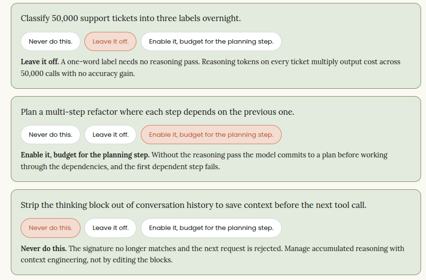
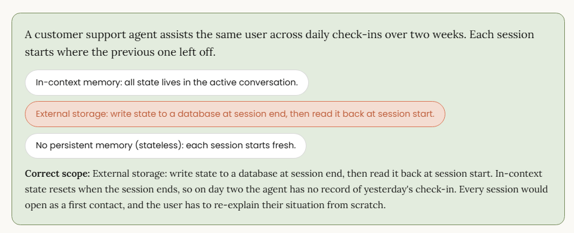
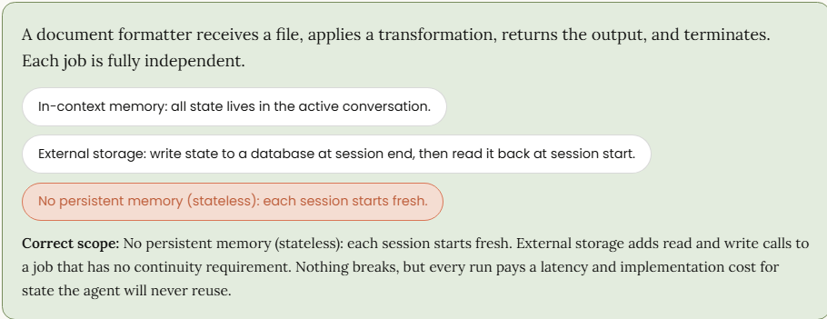
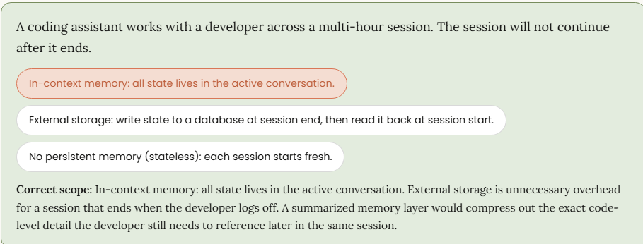

<link rel="stylesheet" href="./tabs.css">

# Production-Grade Prompting, Agents & Tool-use

<span style="font-size: 1.25em;">_Writing code that uses Claude is different from using Claude to write code._</span>

You have probably used Claude interactively when you’ve typed a prompt, read the response, and adjusted it as needed. This module addresses all subsequent aspects of using Claude beyond this basic level, including tool schemas, context management, and agent loops. This module builds upon your ability to shape Claude’s outputs. **As an engineer, you are responsible for programmatically integrating Claude, ensuring reliable output handling, and successfully deploying a robust production solution**.

Each topic in this module addresses a specific failure mode that is frequently overlooked during development but requires significant time and effort to identify and resolve after development is underway. When you learn to identify and avoid these failure modes, you’ll be positioned to effectively and efficiently integrate Claude into your development processes.

## Prompting Craft

### System prompts, XML, few-shot, and output constraints

<span style="font-size: 1.15em;">_A prompt that works once in interactive use often breaks when it runs in production against untested inputs. The fix for this isn’t just adding more words, it is identifying which structural piece is missing from the prompt and adding that one piece. This section reviews how to read a failed output, then walks through the four techniques that produce the fixes._</span>

### Four techniques that give Claude a reliable output shape

When a first-pass response misses, the instinct is often to add more words to the prompt and run it again. However, that instinct can make the problem harder to isolate and rarely fixes it. Rewording changes how you say something but does not add to the structural piece of the prompt that’s missing. For example, if Claude is crossing the boundary between your instructions and your input data, clearer phrasing will not fix it, and if the output format keeps drifting, `"please format this correctly"` will not fix it either.

The failure mode tells you which of the four techniques is absent. Diagnose how your prompt is failing first, then add the specific technique that addresses that failure. The four techniques themselves are defined in full further down this screen.

| What you observed | What the prompt is missing | Why this technique is the fix |
| :-- | :-- | :-- |
| **The result comes back in the wrong shape:** a sentence where you expected a label, prose where you expected JSON. | An output constraint. The prompt never specified the form, field names, or stopping point of the response. | An output constraint controls the form of the response independent of its content. Without one, Claude returns plausible text that the downstream parser was not built to accept. |
| **The content is off:** scope drifts, tone shifts, or Claude answers a wider question than you asked, and it gets worse deeper into the conversation. | A system prompt, or a more specific one. The behavioral contract was too vague to hold across turns. | The system prompt sets the rules that apply to every response regardless of the user turn. When it is underspecified, there is nothing holding role, scope, and format steady as the conversation runs on. |
| **The task is right, but the structure is invented:** Claude understood what to do and produced output in a shape you never asked for. | Few-shot examples. Claude cannot infer an exact structure from a description alone. | Few-shot examples show the pattern rather than describe it. One correct input-output pair gives Claude the exact shape to match, which a written instruction often fails to pin down. |
| **Output is clean on the inputs you tested but breaks on a variant:** an edge case, an unusual field, an input you did not anticipate. | A constraint covering the variant. The prompt handles the happy path and has no rule for the case the parser breaks on. | The prompt was validated against a narrow set of inputs. Naming the variant in the constraint, or adding an example that covers it, closes the gap the test inputs never exposed. |

### Diagnosing a classification prompt that returns the wrong output shape

**The rule is simple:** name the failure, add the one technique that matches it, and re-run it. If it still fails, diagnose again. When a prompt keeps getting longer with every pass, that’s the sign you’re skipping the diagnosis step and just adding words.

The pattern below is the first row of the table in action: a prompt that produces the right content in a shape the downstream code cannot accept. The classifier understands the task and returns the correct category, but the form of that answer varies from run to run, so the router that consumes it fails. The missing piece is an output constraint, and the fix pulls in two of the other techniques to lock the label set and show the format. The walkthrough moves from the bare prompt that causes the problem to the constrained version that resolves it.

#### Worked example: a classification prompt before and after

A developer needs Claude to classify support tickets into three categories: `billing`, `technical`, and `escalation`. The first prompt is a bare instruction with no constraint on the output:


> **System:** `"You are a support classifier. Classify the ticket."`
>
>**User:** <ticket>I was charged twice for the same month.</ticket>

Claude returns `"Billing"` on some runs, `"billing"` on others, and occasionally a full sentence like `"This looks like a billing issue."` The downstream router expects one of a fixed set of labels and breaks on the inconsistency.

Read this against the table above, this situation matches what is described in the first row: the output comes back in a shape the parser cannot accept, so the missing piece is an output constraint. Adding that constraint pulls in two more techniques, because locking the label set and showing the format are jobs those techniques do better than a written instruction can. Few-shot examples show Claude the exact label and casing to return, and XML tags keep those examples separate from the instruction so Claude does not read them as part of the task:

> **System:** `"You are a support classifier. Classify each ticket into exactly one of: BILLING, TECHNICAL, ESCALATION. Return only the label. No other text."`
>
> <sample_input>My account shows two charges for April.</sample_input>
> <ideal_output>BILLING</ideal_output>
>
> <sample_input>The API keeps returning a 429 error.</sample_input>
> <ideal_output>TECHNICAL</ideal_output>
>
> **User:** `<ticket>I was charged twice for the same month.</ticket>`

Three techniques are doing distinct work here. The system prompt sets the output contract: exactly one label from a fixed set, nothing else. The XML tags mark where each example ends and the next begins, so Claude does not read the examples as part of the instruction. The few-shot pairs show the exact casing and format rather than describing it. Together they produce a result consistent enough to route programmatically.

The table below shows how we can stack all the four techniques together, where the prompt should be simplified, and where we should diagnose before adding more before too many iterations.

| | |
| :-- | :-- |
| Stack all four techniques | Stacking all four techniques against a clearly defined output contract. Tasks with well-specified formats and edge cases that can be covered by examples.|
| Simplify the prompt | Adding all four techniques to a simple task that only needs one. A "summarize this paragraph" prompt does not need few-shot examples and an output schema.|
| Diagnose before adding more | Prompts that are growing longer with each iteration rather than more precise. If you have re-prompted five times and the output is still wrong, diagnose the failure type before adding more text.|

### When to reach for each technique

Now, let’s understand more about each of these techniques and when each one applies:

<div class="jb-tabs-container">
<input type="radio" class="jb-r1" name="jb-tab-group-1" id="g1-tab1" checked>
<input type="radio" class="jb-r2" name="jb-tab-group-1" id="g1-tab2">
<input type="radio" class="jb-r3" name="jb-tab-group-1" id="g1-tab3">
<input type="radio" class="jb-r4" name="jb-tab-group-1" id="g1-tab4">

<div class="jb-tabs-header">
<label class="jb-tab-label jb-l1" for="g1-tab1">System Prompts</label>
<label class="jb-tab-label jb-l2" for="g1-tab2">XML Tags</label>
<label class="jb-tab-label jb-l3" for="g1-tab3">Few-shot Examples</label>
<label class="jb-tab-label jb-l4" for="g1-tab4">Output Constraints</label>
</div>

<div class="jb-tab-content">

<div class="jb-tab-panel jb-p1" id="g1-content1">
<p><strong>System Prompts</strong><br/><p>System prompts carry the behavioral contract for the whole session. Write them once and treat them as your persistent instruction layer. <b>They define Claude’s role, the output format, and any rules that must not change between conversations.</b></p>
</div>

<div class="jb-tab-panel jb-p2" id="g1-content2">
<p><strong>XML Tags</strong><br/><p>XML tags are used when the prompt mixes inputs with instructions. A prompt that asks Claude to debug code using provided documentation is a good example; without tags, the code and the documentation look the same to Claude.

Wrap them with descriptive tag names like `<my_code>` and `<docs>` and the boundary becomes unambiguous. You do not need to use official XML tag names; descriptive names that match your content work best.</p>
</div>

<div class="jb-tab-panel jb-p3" id="g1-content3">
<p><strong>Few-shot Examples</strong><br/><p>Few-shot examples are considered useful because they show rather than just tell. Instead of trying to describe the exact format you want, you provide one correct input-output pair and let Claude infer the pattern. To use this, wrap examples using consistent XML structure, for instance < sample_input > and < ideal_output >, so the boundary between example and prompt is clear. You can use some examples from your highest-scoring evaluation outputs rather than writing them from scratch.</p>
</div>

<div class="jb-tab-panel jb-p4" id="g1-content4">
<p><strong>Output Constraints</strong><br/><p>Output constraints are the last line of defense before Claude’s response reaches your parser. You should specify exactly what you need, including field names, types, length limits, whether to include preamble, and what to do when data is absent. Use structured output features in cases when the format must be machine-readable.</p>
</div>

</div>
</div>

### The iteration loop: Diagnosing before re-prompting

When a first-pass response misses the mark, the instinct is to add more words to the prompt and try again. That instinct almost always makes the problem harder to diagnose and rarely fixes it.

Instead, diagnose the problem first, and then re-prompt based on your findings. The failure type tells you which technique is missing:

* **Wrong format:** This is caused due to a missing output constraint. The prompt never specified what shape the result should take.
Wrong content or scope drift: This is caused due to an underspecified system prompt; the behavioral contract was too vague to hold across conversations.
* **Correct task but hallucinated structure:** This happens when few-shot examples are needed. Claude cannot infer the exact structure from a description alone.
* **Good output on simple inputs but breaks on edge cases:** The prompt handles the happy path but has no constraint covering the variant the parser breaks on.

The fix is structural, not a matter of phrasing. For example, if Claude is ignoring a boundary between your instructions and your content, clearer wording will not fix it, and if the output format keeps drifting, saying "please format this correctly" will not fix it either. In each case, identify which of the four techniques is absent and add it.

### Moving output control from the prompt into the API with structured outputs

Everything up to this point shapes the output by writing instructions into the prompt and hoping Claude follows them. That works most of the time, but the prompt is a request, so a model can still return a stray sentence, a wrong field name, or malformed JSON that breaks the parser downstream.

The Claude API has a separate mechanism that removes that gap for production code. It is called structured outputs, and instead of asking for a shape in words, you hand the API a JSON schema, and the model is constrained at generation time to produce output that matches it. This technique is constrained decoding: as Claude generates each token, the API only allows tokens that keep the output valid against your schema, so a response that violates the schema cannot be produced in the first place.

Structured outputs cover two situations that show up in real pipelines. Each one constrains a different part of what the model returns, and you can use them on their own or together in the same request.

* **JSON outputs constrain the final response.** You set the output_config.format parameter with type json_schema and your schema, and Claude returns valid JSON in the response text that matches that schema every time. Reach for this when the model itself is producing the structured payload your code consumes, like extracting fields from a support ticket or formatting an API response, because it removes the parse-and-retry code you would otherwise write around every call.
* **Strict tool use constrains the inputs Claude passes to your tools.** You set strict to true on a tool definition, and the arguments Claude sends to that tool are validated against the input schema before your code runs. Reach for this in agentic loops where a malformed tool argument would crash the function or trigger a wrong action; this helps guarantee the call your code receives already conforms to the contract you defined. 

The reason this belongs in the production code and not just in the prompt is because of reliability under inputs you did not test. A prompt-level instruction to return only JSON holds on the cases you tried and then slips on an edge case you did not, which is the exact failure the earlier classification example walked through. A schema constraint does not slip, because the API enforces it on every token rather than trusting the model to remember the instruction. That moves output correctness from something you verify after the fact to something the API rules out before it happens.

Constraining generation has costs, and a developer choosing this in production needs to weigh them rather than enabling it everywhere by default. Below are some of those costs you must consider:

* **The first request on a new schema is slower.** The API compiles your schema into a grammar before it can constrain output, and that compilation adds latency on the first call. Compiled grammars are cached for 24 hours from last use, so steady traffic on a stable schema pays the cost once, but a workload that changes schemas constantly pays it repeatedly.
* **Your input token count rises.** When structured outputs are on, the API adds a system prompt describing the expected format, and that injected prompt is billed like any other input token. The increase is small per call, but it is worth knowing when you are estimating cost at volume.
* **A guaranteed schema is not a guaranteed success.** Two cases still return output that does not match: a refusal, where the model declines for safety reasons and the response carries stop_reason refusal, and a truncation, where the response hits the max_tokens limit and stops mid-structure with stop_reason max_tokens. Your code still checks stop_reason rather than assuming every response parses.
* **It does not combine with message prefilling.** JSON outputs and prefilling the assistant message are incompatible, so a pattern that starts the response for Claude and a pattern that constrains the whole response to a schema cannot run on the same request. Pick the one that fits the task.

## Extended Thinking

### Turning reasoning on, calibrating effort, and reading it back correctly

<span style="font-size: 1.15em;">_The prompting techniques shape what Claude produces. Extended thinking shapes how much work Claude does before it answers. Turn it on, and the model writes out its step-by-step reasoning first, then gives you the final answer. Your job is to decide when that extra work is worth the cost and to handle the reasoning it sends back._</span>

### What extended thinking does

When you turn on extended thinking, the model "thinks out loud" before it responds. You’ll see this reasoning come back as its own thinking block in the API response, positioned just ahead of the block that holds the actual answer. On the newest models, the thinking block's content is omitted by default; you must request a readable summary through the display setting to see it.

> 📌 **NOTE**<br/><br/>
> **On current models reasoning is adaptive:** you enable it with the thinking parameter where it is not already on by default, and the model decides how much reasoning each request needs. You tune depth with the effort setting rather than a fixed token budget. The older `budget_tokens` control is deprecated and, on the newest model generations, returns a 400 error.

**That reasoning isn’t free**; thinking tokens cost the same as output tokens, so running a simple task at high effort means paying for accuracy you don’t need. The choice here mirrors the one you have already made: match the tool to the task. Don’t reach for extended thinking by default, apply it strategically where needed.

### When to use extended thinking

|Task shape | Extended thinking call | Reason |
| :-- | :-- | :-- |
| Multi-step reasoning where the model has to hold several constraints at once: a math derivation, a multi-hop logic problem, planning a sequence of dependent actions. | Enable it, with the effort level matched to the depth of the problem. | The reasoning pass is where the model works through dependencies it would otherwise skip. |
| Mechanical or lookup tasks: classification, format conversion, extracting a field, short factual answers. | Leave it off. | Extended thinking will not improve the answer, and you will be paying more tokens for something you didn’t need. A bare prompt with an output constraint is the right tool. |
| Agentic loops where the model plans across several tool calls. | Enable it and budget for the planning step rather than per call. | Reasoning before a plan reduces wrong-tool selection downstream. Note the carry-back rule below, which applies in every tool-use loop. |

#### The carry-back rule: thinking blocks must return to the API unchanged

When extended thinking is on and your conversation uses tools, there’s one rule you can’t skip: every thinking block you get back has to go back to the API exactly as it arrived on the next turn. Each block comes with a signature that confirms the reasoning wasn’t tampered with. If you edit it, summarize it, or drop it, the signature stops matching and the API rejects the request.

Redacted thinking blocks work the same way. Their contents are encrypted and not meant to be read by humans, but they still have to be returned untouched.

This is a structural requirement, not a prompting choice you get to make. The most common slip-up is stripping out the thinking block to save context, which ends up breaking your next request. If the real worry is how much context piles up from accumulated reasoning, the fix is the context-engineering work we’ll cover in this module.

> 👉 **Forward pointer**
>
> This lesson enables reasoning and calibrates its effort setting; it does not cover model selection. Choosing which model to run, as distinct from whether to enable reasoning, is taught in the MSO Foundations module that precedes this one.

**Handles well**
Hard reasoning and planning tasks where a wrong answer is expensive and the extra tokens buy accuracy.

**Adds cost or complexity**
The carry-back requirement in tool-use loops, and an effort setting you now must calibrate.

**Use a different approach**
For classification, extraction, and format tasks, a well-constrained prompt is cheaper and just as accurate.



## Tool Usage &amp; Schema Design

### Tool Schemas Claude Selects Correctly: Definition, Loop, and Calling Patterns

<span style="font-size: 1.15em;">_So far, the work has been about shaping what Claude produces: framing the request, giving examples, picking the technique that fits the output you want. With tool-use, you’re not steering language toward a good answer anymore, you’re handing Claude a set of actions and trusting it to pick the right one; that pick is driven almost entirely by what you wrote in the schema._</span>

### How the tool-use loop works

The most common misconception about tool-use is that Claude runs the tools. Instead, Claude reads your tool definitions, decides which one fits the situation, and tells your application what to call it along with the required inputs. Your application executes the tool, gets the result, and sends it back; then Claude uses that result to continue.

This back-and-forth shouldn’t be ignored in production: if your application does not handle the return correctly, Claude never gets the data it asked for, and the loop breaks. The boundary between what Claude owns and what your code owns is where most tool-use bugs live. 

Here is the sequence to ensure proper implementation of tool-use:

1. **Define schema:** You define a schema with a name, a description, and an input schema. Claude reads this to decide whether and when to call the tool.
2. **Send message:** Your code sends a message to Claude including the tool definitions and the user's input.
3. **`tool_use` block:** Claude issues a tool-use block containing the tool name, a unique ID, and the input arguments it wants to pass. The API response comes back with stop_reason: tool_use.
4. **Execute tool:** Your code executes the tool using those arguments. Note that the assistant turn has already ended (Claude is not holding a connection open or waiting on your server). The model is stateless between calls. To continue, your code makes a fresh API request containing the prior messages plus the tool result.
5. **Return result:** You return the result in a tool-result block that references the original tool-use ID.
6. **Claude continues:** Claude continues using the tool result as context for its next response, either another tool-use block or a final end turn.

It’s important to note that the loop is not automatic and you need to complete the fourth step. If the miss is systematic, the fix is in the schema definition step.

### Message block structure in a tool-use conversation

A tool-use conversation is built out of structured blocks, not plain text. Each assistant turn and user turn is a list of blocks, and four block types do the work in a tool-use session. A `text` block carries Claude’s prose response. A `tool_use` block carries a tool call, including the tool name, a unique ID, and the input arguments. A `tool_result` block carries what your code returned after running the tool. A `thinking` block carries Claude’s internal reasoning, and it only appears when extended thinking is enabled.

The API enforces a specific pairing between these blocks. Every `tool_use` block in an assistant turn must be answered by a `tool_result` block with a matching ID in the user turn that immediately follows. If the IDs don’t match, if the result is missing, or if the turns are out of order, the request fails validation. This is not something you can fix by adjusting your prompt; it’s structural, and your code has to produce the sequence correctly on every request.

The table below summarizes each block type, what it contains, and the rule that governs how your code must handle it.

| | | | |
|:-- |:-- |:-- | :-- |
| Block type | Role | Contains | Critical Rule |
`text` block | Assistant/Claude | Claude’s prose output | Claude may return a text block alongside a `tool_use` block in the same turn. When it does, your code must preserve the full content array, including the text block, when appending that turn to conversation history. Dropping the text block corrupts the context Claude relies on for follow-up turns. |
| `tool_use` block | Assistant/Claude | The tool name, a unique ID, and the input arguments Claude wants passed to your function | Every `tool_use` block must be answered by a `tool_result` block in the immediately following user turn. The `tool_result` must carry the same ID. Without that pairing, the API rejects the next request. |
| `tool_result` block | User | Matching `tool_use` ID, the result content, and an optional `is_error` flag set to true when the tool call fails | The `tool_use_id` value must match the original `tool_use` block exactly. Claude uses this ID to connect each result back to the call that produced it, which matters when a single assistant turn issues multiple tool calls and the results arrive in a different order. |
| `thinking` block | Assistant (extended thinking only)/Claude | Claude’s internal reasoning, visible only when extended thinking is enabled | The block must be passed back to the API unchanged in subsequent turns. The signature verifies the reasoning hasn’t been modified, so any edit or summary breaks the signature and the API rejects the message. Redacted thinking blocks follow the same rule: pass them back as received, even though the content is encrypted and not human-readable. |

The critical invariant is that every `tool_use` block from an assistant turn must have a corresponding `tool_result` block in the immediately following user turn. Missing `tool_result` blocks, or `tool_result` blocks that appear in a later turn rather than the immediately following user turn, cause an API validation error.

### Schema anatomy: What Claude reads to make a tool selection decision

A tool schema has three parts, including `name`, `description`, and `input_schema`. The description determines whether Claude selects the tool correctly or not.

1. **Name:** A short identifier that should be specific. For example, `get_account_balance` is more useful to Claude than `get_data`.
2. **Description:** A critical part that Claude reads to decide whether a tool is required or not. You should always write the description in two parts, including when to and when not to use the tool:
    * A description that says "use this to find information" will cause wrong selections because Claude cannot distinguish it from any other tool that retrieves something.
    * A description that says "use this to retrieve the current balance for a specific account ID and do not use this for transaction history" gives Claude an exclusion condition to work with and is appropriately descriptive.
3. **`input_schema`:** Defines the parameters (the inputs your tool function accepts) using JSON Schema.
    * You should mark parameters as required when Claude requires them to call the tool correctly.
    * You can mark parameters as optional when the tool can operate without them. Overlapping parameter types between tools is the most common source of wrong-tool calls.

### Decision table: Schema design choices

The schema is what Claude reads to decide which tool to call, what arguments to pass in, and whether it has enough information to respond. A schema that’s vague, under-described, or missing required fields will produce tool calls that look syntactically correct but pick the wrong tool, pass malformed inputs, or loop unnecessarily. The five decisions below determine whether your implementation behaves predictably under real conditions. The table notes where sequential and parallel tool-calling diverge.

| | | |
| :-- | :-- | :-- |
| Decision | How to handle it | Why it matters |
| **Subtask dependency** | When one tool’s output feeds the next, the calls have to run in sequence because the second call cannot be built until the first result comes back. When the subtasks are independent of each other, you can structure the tool set so Claude issues multiple `tool_use` blocks in a single turn and your code runs them concurrently. | This is the one decision that changes how you design the schema. Current Claude models default to parallel calls when calls are independent. Where a real dependency exists, model it as separate turns so the first result is available before the next call is built. Use `disable_parallel_tool_use` to force one tool call per turn if needed. |
| **Required fields** | Mark a field as required only when the call doesn’t make sense without it. Place these in the required array of the input schema. | Marking everything required forces Claude to fabricate values for fields it has no basis to fill in. The required array is how you tell Claude which inputs are non-negotiable. |
| **Optional fields** | Use optional fields for parameters with sensible defaults or where absence carries meaning. Leave them out of the required array and give them defaults in the function signature. | Optional fields let Claude omit information it doesn’t have, instead of guessing. If a field is optional but marked required, every call must invent a value, which can cause bad inputs. |
| **Description length** | Write three to four sentences per tool covering what it does, when Claude should reach for it, and what it returns. Include examples of valid inputs where format matters. | If the description is too short, Claude guesses because there isn’t enough signal to distinguish your tool from others. If the description is too long, the trigger conditions get buried under detail Claude doesn’t reference at decision time. |
| **Overlapping parameter types** | When two tools accept the same parameter shape, add disambiguating language to each description that names the domain or trigger the tool is meant for. | Claude routes on name plus description, with parameter types as a secondary signal. When signatures are identical, routing collapses to description alone, and similar-sounding descriptions become indistinguishable. |

**Worked example: A schema that causes wrong-tool selection and the fix**

This is an illustrative example based on common patterns observed in tool-use implementations. Tool names, descriptions, and test results are constructed to demonstrate the selection-disambiguation principle, not drawn from a specific production system.

A developer registers two tools, including `search_knowledge_base` and `get_cached_result`. The tool names are distinct, but Claude’s tool selection weighs descriptions heavily; when descriptions overlap, name alone is not sufficient to disambiguate. Both have descriptions that start with _"use this to find information..."_ Without exclusion conditions, Claude frequently selected the wrong tool on ambiguous inputs during development testing.

The problem is that both descriptions look identical to Claude at the point where the selection decision is made. The fix is adding an additional sentence per description:

* `search_knowledge_base`: "Use this to search the knowledge base when the user asks a question that requires looking up current information. Do not use this if the result of a prior search in this session already covers the question."

* `get_cached_result`: "Use this to retrieve a result that was already fetched during this session. Only use this if `search_knowledge_base` was called earlier in this conversation for the same query."

The exclusion conditions give Claude a decision rule rather than two identical-looking options. These conditions rely on complete conversation history being passed in each request. If prior turns are truncated or dropped, Claude cannot evaluate them and the exclusion logic silently fails.

**Every additional tool you register increases the surface area Claude has to reason over**, so this discipline only pays off when the underlying tools are distinct. The table below shows where exclusion-condition disambiguation helps and where a different approach is warranted.

> **Handles well**
> Routing Claude to the right tool reliably when descriptions are specific and exclusion conditions are stated.
>
> **Poor fit**
> Two tools that do similar things and need ever-longer descriptions to keep apart: at that point, merge them into one tool with a type parameter instead.

### When someone else has already written your tools: MCP as an alternative to manual schema authoring

Everything in the previous sections assumes you are writing the tool schemas yourself: `name`, `description`, `input_schema`, and the function that executes when Claude issues a `tool_use` block. For many integrations, you do not need to do that. The Model Context Protocol (MCP) is a standardized communication layer that moves tool definitions and execution out of your application code and into dedicated servers. When an MCP server exists for the service you want to reach, you can connect directly to the MCP server rather than building the integration yourself.

Take a GitHub integration as a concrete case. GitHub exposes repositories, pull requests, issues, projects, and more. To build a complete integration using the tool schema approach from this module, you would need to write a schema and an execution function for every piece of that functionality and maintain it as GitHub’s API evolves. An MCP server for GitHub has already done that. So, your application connects to the server, receives the full list of available tools, and Claude selects among them using the same description-based routing you have already been working with. The underlying mechanism is identical, but what changes is who wrote it and who owns the tool definitions.

### How MCP fits into the tool-use loop

The loop you built earlier in this module does not change when you introduce MCP. Claude still issues a `tool_use` block, your application still executes the tool and returns a `tool_result`, and the message block pairing rules still apply. The difference is in the setup step. Instead of registering schemas you wrote, your MCP client sends a `ListToolsRequest` to the MCP server, receives the full tool list back, and passes those definitions to Claude. From Claude’s perspective, those tools are indistinguishable from ones you authored manually.

**One practical implication worth noting**: MCP servers add tool definitions to the context window even when the tools are not being used in the current turn. If you connect several servers at once, the tool definitions themselves consume budget before the first message arrives. The schema design discipline from earlier in this module applies here too. Register only the servers you are actively using, and check context cost against your window limit if you are connecting multiple servers in the same session.

If you are using the API MCP Connector, you control loading cost through an `mcp_toolset` object in the tools array. The `mcp_toolset` carries a `default_config` block that applies to every tool on the server, and you can override individual tools through configs keyed by tool name. Two settings matter for context cost:

* The `defer_loading` boolean, set inside `default_config` or a per-tool entry in configs, delays loading a tool definition until the model needs it, which reduces upfront context cost when you connect a server with a large tool list.
* The `enabled` boolean turns individual tools on or off, so you can register a server but expose only the tools you want the model to see. The MCP Connector requires the `mcp-client-2025-11-20` beta header to be set on the request.

Without that header, the `mcp_toolset` configuration will not apply as described here.

The other piece worth knowing at this stage is how the client actually talks to the server. MCP runs over one of two transports, and which one you use depends on where the server lives. **Local servers use `stdio`** and your application spawns the server as a subprocess and communicates over standard input and output. **Remote servers use `Streamable HTTP`** and your application connects over the network via HTTP, using POST for client-to-server messages and an optional GET-based SSE stream for server-initiated messages. An older SSE-only transport exists but is deprecated, and new integrations should use Streamable HTTP. One constraint worth flagging if you are using Anthropic’s MCP connector in the API: only HTTP-exposed servers are supported through the connector, and stdio servers require managing the MCP client connection yourself via the SDK. Once the connection is established and tool definitions are received, your application code treats both transports identically.

> [!Tip]
> <small>**USE MCP WHEN**</small>
>
> A well-maintained MCP server already exists for the service you need (check that it covers the specific operations you require and is actively maintained against the service’s current API. Writing and owning those schemas yourself adds implementation overhead for no additional capability. **Note that the Claude API MCP Connector only supports remote servers**. Local stdio servers require Claude Desktop or Claude Code as the client; they cannot be connected directly through the API.

> [!Tip]
> <small>**WRITE SCHEMAS MANUALLY WHEN**</small>
>
> No MCP server covers your use case, or when you need precise control over tool scope and description quality that a general-purpose server does not provide. Before defaulting to manual schemas for scope control, note that the API MCP Connector supports allowlisting and denylisting specific tools per server via MCPToolset configuration. Manual authoring may still be warranted for description quality, but not always for scope.

> [!Tip]
> <small>**USE BOTH WHEN**</small>
>
> Connect to an MCP server for breadth then apply the description-tuning discipline from earlier in this module to the specific tools you are actively routing to. MCP and manual schema authoring are not mutually exclusive as the server gives you coverage, and your descriptions give you precision where it matters. Apply tool allowlisting via MCPToolset to limit the surface area Claude reasons over before layering in description tuning. Narrowing the tool set and sharpening the descriptions are two separate levers, and you should use both.

### The description that sent Claude to the wrong tool

> [!Tip]
> <small>SETUP</small>
>
> **A schema can look correct and still fail**. Typed parameters and passing happy-path tests tell you the structure is valid, but they do not tell you whether Claude can reliably choose between your tools when an input sits near the boundary of two overlapping descriptions. That is the failure mode that initial testing misses and the one most likely to surface during production.

**A Developer is three hours into a code review when they paste an internal channel conversation into a debug session.**

_This is a composite exchange based on common patterns in developer debugging conversations. The dialogue is constructed to illustrate the diagnostic moment when description overlap gets named, not transcribed from a specific code review._

Let’s look at the exchange below that happens after a Developer has been debugging incorrect tool selections since morning. The Senior Developer asks one question that reframes the whole problem:

> **Developer**: "Why does Claude keep calling search_docs when the answer is already in the context? I've re-run this four times, and it keeps going to the wrong tool."
> 
> **Senior Developer**: "What does the description for search_docs say?"
> 
> **Developer**: "'Use this to find information about the product.'"
> 
> **Senior Developer**: "And what does get_context_summary say?"
> 
> **Developer**: "'Use this to retrieve relevant information from the current session.'"
> 
> **Senior Developer**: "Those descriptions are the same thing from Claude's perspective. Both say, 'find information.' One of them needs to say when not to call it."
> 
> **Developer**: "So, I need to add an exclusion?"
> 
> **Senior Developer**: "Right. Try using search_docs ‘when the user asks a question that requires looking up content not already present in this conversation. Do not call this if the answer is available in the current session context.' Then get_context_summary handles the in-context case. You will want to tighten get_context_summary's description the same way: add 'Only use this if the answer is already present in the current session. Do not use this to look up new information.' Both tools need the boundary, not just one."
> 
> **Developer**: "That's two sentences."
> 
> **Senior Developer**: "Right. One to say when to use it, one to say when not to. That's the whole fix."

> [!Important]
> <small>WHAT TO WATCH OUT FOR</small>
>
> Claude selects a tool by reasoning over all registered descriptions in the context of the full conversation. When two descriptions look similar, that reasoning has no reliable signal to distinguish them so Claude picks based on small surface differences that may not correspond to the distinction you intended.
>
> When the failure is overlapping descriptions, the fix is consistent: add one sentence naming when not to call the tool to give Claude a decision boundary. If the descriptions cannot be cleanly separated even with exclusion conditions, the tools may need to be merged into one with a type parameter instead.

## Streaming Responses

### Streaming responses and handling partial output without corrupting state

<span style="font-size: 1.15em;">_Every request so far has waited for the whole response to arrive before doing anything with it. That's fine, until the response is long, or a user is sitting there staring at a blank screen. Streaming sends the response in pieces, sending them along as the model generates them. That makes things feel faster, but it also gives your code a new job: now you are tasked with assembling the final content yourself based on the series of outputs, and you need to be prepared if the series stops early._</span>

### What streaming changes about the response

In a non-streamed request, the API hands you one complete message with every content block, fully formed. In a streamed request, the API instead sends a series of events that describe the message as it's being built. Your code listens to that series and reassembles the blocks. The message you end up with is identical to what a non-streamed call would have given you, but the difference is that you have to assemble the pieces, and you decide what to do if the events stop before the message is finished.

It helps to know what's not happening: the model isn't holding some live object open for you. Each event is its own small message describing a single change, a block started, some text or input got added to it, a block finished, the whole message finished. Your handler takes each event and applies it to the partial state it's been building up.

### The event sequence, and what your handler does with each

| | | |
| :-- | :-- | :-- |
| Event | What it signals | What your handler does |
| `message_start` | A new message is beginning. Carries the message shell with empty content and initial usage. | Set up an empty content array to collect blocks in. |
| `content_block_start` | A new content block is opening, with its type (text, tool_use, or thinking) and index. | Make a slot at that index for the named block type. A tool_use block opens with its name and id, but no input yet. |
| `content_block_delta` | An incremental piece of one block: a text fragment, a fragment of JSON input for a tool call, or a thinking fragment. | Append the fragment to the block at that index. Tool-call inputs arrive as a partial JSON string spread across several deltas, you can't parse them until the block closes. |
| `content_block_stop` | The block at this index is complete. | Finalize the block. For a tool_use block, this is the first moment the accumulated JSON input is complete enough to parse. |
| `message_delta` | Top-level changes to the message: the stop_reason and final usage counts. | Record the stop_reason. It tells you whether the model finished or stopped for some other reason. |
| `message_stop` | The stream is complete. | The assembled content array is now the finished message. From here, treat it exactly like a non-streamed response. |

### The rule that keeps your state from getting corrupted: don't act on a partial block

The `tool_use` block is the one to watch. Its input shows up as a partial JSON string spread across many `content_block_delta` events, and that string isn't valid JSON until `content_block_stop` closes the block. If your code tries to parse the input or run the tool before the block closes, it either chokes on malformed JSON or runs with half the arguments missing. So, the rule is simple: collect the deltas, and act only after `content_block_stop` for that block.

The same discipline applies when you add a streamed assistant turn to your conversation history. Add it only after `message_stop`, with every block fully assembled. A turn built from a stream that got cut off partway is incomplete, and the `tool_use` pairing rules will reject your next request if a half-built `tool_use` block ends up in the history.

### When the stream stops early

Streams sometimes fail in the middle. A dropped network connection, a timeout, or a client disconnect can end the event series before `message_stop` arrives. The failure that really bites is treating whatever you've collected so far as if it were complete. A partial text block shown to a user is just a cosmetic glitch and a partial tool_use block written into history is a structural problem that corrupts the next turn.

* **Track completion on purpose**. A turn is usable only once message_stop has arrived. Until then, treat what you've accumulated as provisional.
* **On an interrupted stream, throw away the partial assistant turn** instead of saving it to history, then retry the request. Committing a half-built turn is exactly what breaks the following request.
* **Check the `stop_reason` from `message_delta` before you continue a loop**. A `stop_reason` of `tool_use` means your assembled tool calls are ready to run; any other value means you're on a different path, not the tool path.

> **Handles well**
> Long responses and user-facing interfaces where showing output as it generates removes the blank-screen wait.
> 
> **Adds cost or complexity**
> You assemble blocks yourself, you must not act on partial blocks, and you must handle mid-stream interruption explicitly.
> 
> **Use a different approach**
> For short responses or backend jobs where no one is waiting on the output, a non-streamed call is simpler and removes the partial-state risk entirely.
> 

### The stream that left a half-written tool call in the history

> [!Tip]
> <small>SETUP</small>
>
> A streamed response can look fine on screen and still corrupt the next request. The text rendered, the user saw an answer, and the handler appended the turn to history. What the handler did not catch was that the stream dropped mid-block, so the tool_use call it stored was missing half its input. The next request fails validation, and the error points at the next turn and not the stream that caused it.

**Postmortem: partial tool_use block committed to history after a dropped stream**

An agent used streaming so its operators could watch responses generate in real time. The handler accumulated content_block_delta events and appended the assistant turn to history when its read loop ended. In testing on a fast local connection, streams always ran to completion, so the loop always ended at message_stop and the stored turns were always complete.

In production, a network blip ended one stream after the tool_use block had opened and received part of its JSON input, but before content_block_stop. The read loop ended the same way it always had, so the handler appended the turn: an assistant turn containing a tool_use block whose input string was truncated JSON. The operator saw a partial answer and retried. The retry request included that corrupted turn in history, and the API rejected it with a validation error pointing at the malformed tool_use block.

The team spent an afternoon inspecting the schema and the retry logic, because the error surfaced on the retry request. However, the actual cause was upstream: the handler treated 'the read loop ended' as equivalent to 'the message is complete,' and those are not the same.

> [!Important]
> <small>WHAT TO WATCH OUT FOR</small>
>
> A stream ending is not the same as a message completing. Only message_stop means the message is whole. If your handler commits a turn whenever its read loop exits, an interrupted stream writes a half-built block into history, and the failure shows up on the next request rather than the one that caused it. Gate the history append on message_stop, discard the partial turn on interruption, and retry from the last complete turn. When a tool-use error appears on a retry, check whether the prior turn was assembled from a stream before you touch the schema.

Here is how you would typically process streaming response:

```python
"""Stream one assistant turn from the Claude API and rebuild its content blocks.

Example context: a BFSI assistant that can call a loan EMI calculator tool.
"""

import json
import logging
from typing import Any

import anthropic
from anthropic.types import RawContentBlockDelta, RawContentBlockStartEvent

logger = logging.getLogger(__name__)

MODEL = "claude-haiku-4-5"
MAX_TOKENS = 4096

# Tool inputs stream as JSON fragments. We buffer them under this private key
# and replace the buffer with a parsed dict in assemble().
_JSON_BUFFER = "_partial_json"

# Block types whose "input" arrives as input_json_delta fragments.
_TOOL_BLOCK_TYPES = {"tool_use", "server_tool_use"}


class StreamInterruptedError(RuntimeError):
    """Raised when a stream ends before the message_stop event."""


# One client per process. It reads ANTHROPIC_API_KEY from the environment.
client = anthropic.Anthropic()


def init_block(event: RawContentBlockStartEvent) -> dict[str, Any]:
    """Create an empty, mutable block from a content_block_start event.

    Args:
        event: The content_block_start event from the stream.

    Returns:
        A plain dict in the shape the Messages API accepts as assistant content.
    """
    block = event.content_block
    block_type = block.type

    if block_type == "text":
        return {"type": "text", "text": block.text or ""}

    if block_type == "thinking":
        return {
            "type": "thinking",
            "thinking": block.thinking or "",
            "signature": block.signature or "",
        }

    if block_type in _TOOL_BLOCK_TYPES:
        # The start event carries an empty input; the real input streams in later.
        return {
            "type": block_type,
            "id": block.id,
            "name": block.name,
            "input": {},
            _JSON_BUFFER: "",
        }

    # redacted_thinking and server tool results arrive complete in the start
    # event, so we pass them through unchanged.
    return block.model_dump(exclude_none=True)


def apply_delta(block: dict[str, Any], delta: RawContentBlockDelta) -> None:
    """Merge one content_block_delta payload into its block, in place.

    Args:
        block: The block created by init_block for this event index.
        delta: The delta payload from a content_block_delta event.
    """
    delta_type = delta.type

    if delta_type == "text_delta":
        block["text"] += delta.text
    elif delta_type == "thinking_delta":
        block["thinking"] += delta.thinking
    elif delta_type == "signature_delta":
        # Sent once, just before the block closes. It must be sent back to the
        # API unchanged, or a later request that includes this block is rejected.
        block["signature"] = delta.signature
    elif delta_type == "input_json_delta":
        block[_JSON_BUFFER] += delta.partial_json
    elif delta_type == "citations_delta":
        block.setdefault("citations", []).append(
            delta.citation.model_dump(exclude_none=True)
        )
    else:
        # A newer delta type this code does not know about. Log it so the gap is visible.
        logger.warning("Ignoring unknown delta type: %s", delta_type)


def assemble(blocks: dict[int, dict[str, Any]]) -> list[dict[str, Any]]:
    """Turn accumulated blocks into final assistant content.

    Args:
        blocks: Mapping of stream block index to block dict.

    Returns:
        Content blocks ordered by index, with tool inputs parsed into dicts.

    Raises:
        ValueError: If a tool block's accumulated JSON is invalid, for example
            when max_tokens cut the output mid-argument.
    """
    content: list[dict[str, Any]] = []
    for index in sorted(blocks):
        block = dict(blocks[index])  # shallow copy so the input mapping stays untouched
        if _JSON_BUFFER in block:
            raw = block.pop(_JSON_BUFFER)
            try:
                # No arguments streamed means a tool call with an empty input.
                block["input"] = json.loads(raw) if raw else {}
            except json.JSONDecodeError as exc:
                raise ValueError(
                    f"Invalid tool input JSON for block {index} "
                    f"({block.get('name')}): {raw!r}"
                ) from exc
        content.append(block)
    return content


def stream_turn(
    messages: list[dict[str, Any]],
    tools: list[dict[str, Any]],
    model: str = MODEL,
) -> None:
    """Stream one assistant turn and append it to messages on success.

    Args:
        messages: Conversation history. Mutated only if the turn completes.
        tools: Tool definitions in the Messages API format.
        model: Model identifier.

    Raises:
        StreamInterruptedError: If the stream ends before message_stop.
    """
    blocks: dict[int, dict[str, Any]] = {}
    stop_seen = False

    with client.messages.stream(
        model=model, max_tokens=MAX_TOKENS, messages=messages, tools=tools
    ) as stream:
        for event in stream:
            if event.type == "content_block_start":
                blocks[event.index] = init_block(event)
            elif event.type == "content_block_delta":
                apply_delta(blocks[event.index], event.delta)
            elif event.type == "message_stop":
                stop_seen = True

    if stop_seen:
        messages.append({"role": "assistant", "content": assemble(blocks)})
    else:
        raise StreamInterruptedError(
            "Stream ended before message_stop; discarding partial turn. "
            "Retry from the last complete turn."
        )


if __name__ == "__main__":
    print(f"anthropic SDK version: {anthropic.__version__}")

    emi_tool = {
        "name": "calculate_emi",
        "description": "Calculate the monthly EMI for a loan.",
        "input_schema": {
            "type": "object",
            "properties": {
                "principal": {"type": "number", "description": "Loan amount in INR."},
                "annual_rate_pct": {"type": "number", "description": "Interest rate, e.g. 9.5."},
                "tenure_months": {"type": "integer", "description": "Loan tenure in months."},
            },
            "required": ["principal", "annual_rate_pct", "tenure_months"],
        },
    }
    history = [
        {
            "role": "user",
            "content": "What is the EMI on a 50 lakh home loan at 8.75% for 20 years?",
        }
    ]
    stream_turn(history, [emi_tool])
    print(json.dumps(history[-1], indent=2))
```

## Context Engineering

### Model selection and keeping multi-turn sessions in budget

<span style="font-size: 1.15em;">_You make one early choice: which model runs the workload. The Claude family covers a range of cost, latency, and capability tradeoffs, so the model you pick sets the price and speed floor that every later decision moves within._</span>

Once the model is set, the next constraint is the context window: the full span of text the model can take in at once, including your prompt, the conversation so far, and every tool result. Every tool result Claude returns gets appended to the context window and stays there for the rest of the session. In a single-turn prompt, that's invisible. In a multi-step agent session running ten or twenty tool calls, the window fills up fast, and once it fills, the agent either compacts (losing detail) or stalls before the task is done.

So, the question for any agent workflow is whether you've decided in advance what goes into the context window, what comes back out as a summary, and what never enters at all. That set of choices is context engineering.

### Model selection: Start with Sonnet, move deliberately

The Claude model family currently spans four tiers: Fable, Opus, Sonnet, and Haiku, each optimized for different cost, latency, and capability tradeoffs. Sonnet is the balanced default for most production workloads. Haiku is built for speed and cost efficiency on tasks that fit its capability envelope. Opus handles demanding work above the Sonnet envelope, and Fable is Anthropic's most capable model, built for the most demanding tasks including complex reasoning, advanced coding, research synthesis, and sophisticated agentic workflows where maximum intelligence is the priority. Confirm the current lineup and model identifiers against platform.claude.com/docs at build time.

The default starting point is Sonnet. Move up to Opus only when an eval set tells you Sonnet isn't meeting your quality bar. Move down to Haiku only when an eval set tells you the quality regression is acceptable at your task, not just to save costs. Your decision to move models should always be a measured decision.

### The context window is not a free resource

Think of the context window as the amount of space Claude can hold in working memory. Every message you send, every tool result you return, every document you inject, and every response Claude generates occupies space in that window. If a request is already larger than the context window, the Messages API rejects it with a validation error before generation; if a request fits but generation reaches the ceiling partway, current models return the output generated so far with a `model_context_window_exceeded` stop reason. Neither path silently truncates your oldest content. If you want a session to keep running past the window limit, your application must manage that itself by trimming or summarizing history before the next request goes out.

In development, the window rarely fills because test inputs are small and sessions are short. In production, tool outputs are often three to five times longer than test fixtures, sessions run for more turns, and the window fills at turn eight rather than turn fifty, which means they fill earlier than development. The cost of not planning for this is a production outage.

### Four strategies for staying in budget

The previous section made the case for moving state out of the live context window. The reason behind that is the budget. Every token in the window costs money on input and adds latency to the response, and a long session compounds both. The four strategies below are concrete ways to manage that budget, each suited to a different shape of conversation.

| Strategy | What it does | When to apply | What continuity you lose |
| :-- | :-- | :-- | :-- |
| Pruning | Lets you jump back to an earlier message and continue from there, removing the conversation that came after. | After Claude has gone down an unproductive path or accumulated debugging back-and-forth that won't help the next task. | The work done after the rewind point is gone. If Claude learned something useful in that stretch, it has to relearn it. |
| Compaction (`/compact` in Claude Code; server-side compaction in the API, a beta strategy the platform performs for you, with manual summarization as the client-side alternative) | Summarizes the conversation history into a condensed version that preserves the key information Claude has learned. The summary costs fewer tokens than the original turns. | When the session is approaching the context ceiling but you want to keep working on the same feature with the knowledge Claude has built up. | Details can be lost in the summarization. Anything not captured in the summary will not be available to Claude going forward. |
| Clearing (`/clear` in Claude Code; new session in API) | Starts a new conversation with empty context. Nothing from the previous session carries forward. | When the next task is completely different from the current one, and previous context would only introduce bias or confusion. | All session context is gone. Anything Claude needs to remember across sessions has to be put somewhere persistent, like a CLAUDE.md file. |
| Subagent Handoffs | Spawns a subagent in its own isolated context window with only the task description and system prompt it needs. The subagent does the work and returns a summary. | When a subtask is self-contained enough to delegate, especially exploration work where the journey clutters the main context but the answer is short. | Visibility into how the subagent reached its conclusion. The intermediate steps are discarded with the subagent's context. |

### Two more levers: prompt caching and token counting

The four strategies above manage what enters the context window. Two API features reduce what you pay for what's already there.

Prompt caching stores the processing work done on a stable prefix of your request so follow-up requests can reuse it instead of reprocessing the same tokens. The first request writes the prefix to cache; subsequent requests that send identical content up to that point pay a fraction of the original cost. The strongest candidates are parts of the request that rarely change across turns: a long system prompt, a large tool definition set, or a reference document you query repeatedly. You enable caching by marking a cache breakpoint with a cache_control field of type ephemeral on the last block you want cached. You can place up to four breakpoints. For multi-turn sessions with a stable system prompt and tool schemas, caching those prefixes once and reusing them across turns is the highest-leverage cost reduction available.

Token counting lets you measure context pressure before a request goes out rather than after it fails. The count_tokens endpoint takes the same request body as a messages call and returns the token count without running inference. Use it during development to verify your context budget assumptions hold against real tool outputs, not just test fixtures, and in production to gate requests that would exceed the window before they error.

### The three places a RAG path can break

The path has three places where it can go wrong: the chunking, the embedding match, and the assembly into the prompt.

* **Chunking** decides what a unit of retrievable context is. Split too small and a single chunk lacks the surrounding context to be useful. Split too large and one chunk dilutes the match with unrelated text. Sentence-based or section-based chunking with a little overlap is a reasonable default. The overlap matters because facts that cross a boundary would otherwise be split apart and become difficult to retrieve.
* **The embedding match** decides which chunks are returned. It uses a similarity search, so it retrieves content that is semantically close. This is not always what contains the exact term you need. A query for a specific identifier can miss the relevant chunk if a more semantically similar result outranks it. This is why a lexical match is sometimes run alongside the semantic one.
* **The assembly step** is where retrieved chunks must reach the model in the structure the prompt expects, otherwise the model answers from memory instead of from the retrieved text.

The fetch-once path gives you a system you can reason about: you can inspect which chunks were retrieved for a query and test that retrieval directly. The cost is the infrastructure: the index that must be built, stored, kept in sync as the corpus changes, and secured wherever it lives. The search-across-rounds path removes that infrastructure and the staleness that comes with it, since the model reads the current files at query time, at the cost of spending more tokens and time per query and giving you a less inspectable process. For a stable reference corpus queried with simple lookups, the index is worth owning. For a changing corpus or multi-step questions, the iterative search is usually the simpler system despite costing more per query.

The reported performance gain for single-agent agentic search over a retrieval index is a version-pinned figure. Confirm it against the reference layer at build time rather than relying on the number in this module.

Now, let's understand a bit about two of the most common strategies: compaction and subagent handoffs.

### Applying compaction: What gets preserved depends on how you write the summarizer

When you use `/compact` in Claude Code, the tool decides what to include in the summary. In the API, the documented primary strategy is server-side compaction (beta): the platform summarizes the conversation for you when it is configured on the request. When you instead implement manual compaction in an API session, you write the summarizer prompt yourself. That prompt determines what the agent will know in subsequent turns.

**Summarizer prompt says `"summarize the conversation so far"`**

Produces a general summary that may drop task-critical state, which files were modified, what decision was made at a branch point, and what error was encountered and resolved.

**Summarizer prompt says `"summarize the conversation, preserving all file paths modified, all decisions made, and any errors encountered and their resolutions"`**

Produces a summary the agent can use.

This is not an edge case; task-critical state loss from an under-specified summarizer is one of the most common sources of multi-session agent failures.

### Subagent handoffs: Managing long-horizon tasks

When a task is too large for a single context window, increasing the window is not a solution. The solution is to decompose the task and pass only the relevant context to each subagent. A subagent receives a scoped task and the minimum context it needs, the results of prior steps that are directly relevant, the tools it needs to complete its task, and clear exit conditions. The parent agent collects the results. This pattern keeps per-turn cost low and makes long-horizon tasks tractable.

Like compaction and pruning, subagent handoffs add implementation overhead, so apply them only where context cost is a real constraint: a simple single-turn prompt or short workflow doesn't need this.

**Handles well**
Multi-step agent sessions that exceed the token budget and need decomposition. Best designed at the architecture stage rather than patched in as a production fix.

**Use a different approach**
Pipelines that never approach the window limit. Measure actual token usage against your model's context limit before adding management overhead.

> [!Tip]
> <small>FORWARD POINTER</small>
>
> The strategies covered so far assume you know your context budget is under pressure and you are choosing a tool to manage it. The critical point here is not to know the pressure exists until the session breaks. A workload can pass every test in development and then fail in production for one reason: the tool output got bigger, the sessions got longer, and the context window that held twenty turns cleanly now fills at turn eight. The next section walks through exactly how that happens, using a worked postmortem of an agent that ran fine on test fixtures and then hit its ceiling once real documents started flowing through it.

### The session that ran fine in development, then hit a ceiling in production

> [!Tip]
> <small>SETUP</small>
>
> Tool outputs consume context the same way prompts and file reads do. The context window is a fixed budget that holds everything Claude needs to see on a given turn: the system prompt, the conversation history, and every tool call and tool result accumulated so far. When tool outputs are short, each turn adds a small amount to that running total and the budget lasts a long time. When tool outputs grow larger, each turn adds more to the same running total, and the budget runs down faster. The window itself has not changed; what changed is how much of it each turn now spends. A session that handles twenty turns cleanly in development can start failing at turn eight in production for exactly this reason.

**Postmortem: Context budget never measured against production tool outputs**

An agent was built to process sales receipts under a 40k context window token budget, a cap the team set as a cost control on the agent's context rather than the model's ceiling. The model itself offered far more room. Current Claude API models carry at least a 200k-token context window, and the newest flagship models, Fable included, serve 1M tokens by default, so the 40k figure was a deliberate budget the team imposed, not a limit the model forced on them. Development used a test fixture set of twenty receipts, each returning a tool result of roughly 800 tokens. The full twenty-turn session consumed about 18,000 tokens, well within the team's 40k token budget limit.

In production, receipts contained supporting documentation, including transaction records, and correspondence. Average tool output grew to approximately 3,200 tokens per call. Eight turns of tool output alone added up to roughly 25,600 tokens, and once the system prompt, user messages, and assistant messages were added on top, the running total reached the team's 40k budget cap. The agent hit that cap at turn eight, before it could complete its analysis. The failure looked like degraded tool selection because the agent started choosing the wrong tools and returning incomplete analyses. However, the underlying cause was different. The system prompt and early instructions had been crowded out by accumulated tool outputs that were never pruned after use, and the agent was making decisions on a context window that no longer contained the guidance it had started with.

| | Development | Production |
| :-- | :-- | :-- |
| Context window available | 200k standard, 1M on current Opus and Sonnet | 200k standard, 1M on current Opus and Sonnet |
| Team budget cap | 40k tokens | 40k tokens |
| Avg. tool output | ~800 tokens per call | ~3,200 tokens per call |
| Turns before window fills | Sessions completed without reaching the cap | Cap reached at turn 8 |
| Observed symptom | None. Sessions complete cleanly | Wrong tool selections and incomplete outputs starting turn 8 |
| Root cause identified by | Not applicable | Token usage audit, two days after deployment |
| Fix | Not applicable | Prune tool outputs after use, and apply compaction proactively before the cap is reached |

> [!Caution]
> <small>WHAT TO WATCH OUT FOR</small>
>
> The development test fixtures were shorter than production data. This is true for almost every agent built against a fixture set. The fix is to measure the actual token cost of a tool result against the largest input you can find in your target data before the agent ships.
> 
> The symptom of context overflow is often misread as a tool selection failure, because the output looks similar. If you see tool selection degrade after a fixed number of turns, check whether the context window is filling before you start debugging the schema.

## Agent Construction

### Building a production agent: the loop, wiring paths, orchestration, and human-in-the-loop

<span style="font-size: 1.15em;">_An agent is a multi-step tool-use loop with managed context and a defined goal. You have already built the individual pieces, including tool schemas and context management. This section connects them into a working system and adds the layer that neither topics cover on their own._</span>

When components run together across multiple turns, new failure modes appear that isolated testing does not catch. Routing decisions that worked in single-turn tests start to compound. Context fills faster than expected. A step that depends on a previous result gets the wrong input because an earlier tool call was structured incorrectly. The question that should precede every agent build is: does this problem require an agent?

Agents carry coordination overhead, expanded context costs, and more surface area for failure than simpler patterns. Answering that question deliberately is the first design decision.

### Workflow or agent: Make this decision before you write the first line

The most critical mistake in agent development is choosing the wrong pattern at the start. Workflows and agents solve different problems: using an agent when a workflow is sufficient adds behavioral complexity without adding capability. Using a workflow when an agent is needed produces a system that breaks whenever user input deviates from the predetermined path.

| Choose a workflow when… | Choose an agent when… |
| :-- | :-- | 
| You can enumerate the exact steps in code. | You can specify the goal and the tools but not the exact path. |
| Error cost is real and step-level guardrails matter. | The path through work cannot be enumerated in advance. |
| Observability with standard tooling is required. | Non-determinism is acceptable and the agent's possible actions are constrained by its registered toolset. |
| The inputs are well-constrained to a known set. | User inputs vary unpredictably in content and structure. |
| Every execution of the task follows the same sequence. | The task requires creative sequencing of available tools. |

### The agent is the pattern. The wiring path is an implementation choice.

Once you have decided the task needs an agent, you have also decided on a pattern: a loop that calls tools, manages context, and runs until a goal is met. For single-agent systems, that pattern is constant across all three wiring paths. Multi-agent architectures, where a planner, executor, and evaluator run as separate agents handing off through structured artifacts, introduce additional design decisions beyond the loop itself. Those patterns are covered later in this track. That pattern does not change based on how you build it, what changes is how much of the loop you write yourself versus how much you hand to a library or a hosted service.

There are three wiring paths, and they sit on a spectrum of how much infrastructure you own. You can write the loop directly against the Messages API, which gives you full control and full responsibility. You can use the Agent SDK, which runs the same loop inside your own process and hands you tool execution, context management, and the iteration structure already built. Or you can use Claude Managed Agents (currently in public beta), where Anthropic runs the loop and the sandbox and your application streams events in and results back. The sections that follow teach the loop itself, because the loop is what stays constant. The path you choose decides who maintains the parts around it.

### Wiring paths: who runs the loop, and what you take on

The three paths differ in one variable: how much of the agent's runtime you own. The table is ordered from top to bottom by how much infrastructure you hand off. Choose based on your deployment and compliance constraints, don't be tempted to choose the path that is just fastest to prototype.

<div class="jb-tabs-container">
<input type="radio" class="jb-r1" name="jb-tab-group-2" id="g2-tab1" checked>
<input type="radio" class="jb-r2" name="jb-tab-group-2" id="g2-tab2">
<input type="radio" class="jb-r3" name="jb-tab-group-2" id="g2-tab3">

<div class="jb-tabs-header">
<label class="jb-tab-label jb-l1" for="g2-tab1">Raw Messages API Loop</label>
<label class="jb-tab-label jb-l2" for="g2-tab2">Agent SDK</label>
<label class="jb-tab-label jb-l3" for="g2-tab3">Claude Managed Agents</label>
</div>

<div class="jb-tab-content">

<div class="jb-tab-panel jb-p1" id="g2-content1">
<p><b>Who runs the loop:</b> Your code runs every iteration. You send the request, read the tool-use blocks, execute the tools, and append the results yourself.

<b>What you own:</b> The full loop, tool execution, context management, retries, and exit conditions. Nothing is provided for you.

<b>Choose this when:</b> You need full control over each step, you have constraints a library does not accommodate, or you are teaching yourself how the loop works before adding abstraction.

<b>What to check before committing:</b> The maintenance cost is yours. Every behavior the SDK would give you for free, including context management and parallel tool handling, becomes code you write and test.</p>
</div>

<div class="jb-tab-panel jb-p2" id="g2-content2">
<p><b>Who runs the loop:</b> The SDK runs the loop inside your own process. It iterates and manages context, and your code still executes the tools the agent calls.

<b>What you own:</b> Tool execution and the surrounding application. The SDK provides the loop structure, context management, and tool registration.

<b>Choose this when:</b> You want the loop, context handling, and tool scaffolding that power Claude Code without rebuilding them, and you want the agent running in your own environment in Python or TypeScript.

<b>What to check before committing:</b> Whether filesystem-based features like CLAUDE.md and skills load in the Agent SDK is controlled by the settingSources configuration. Do not rely on a default: always set settingSources explicitly to the sources you intend (for example, ["user", "project", "local"] to match Claude Code CLI behavior, or [] to run fully isolated with only what you pass programmatically). Confirm current default behavior against the Agent SDK reference at build time.</p>
</div>

<div class="jb-tab-panel jb-p3" id="g2-content3">
<p><b>Who runs the loop:</b> Anthropic runs the loop and the sandbox. Your application sends user events and streams results back over server-sent events.

<b>What you own:</b> The application layer and the agent definition. You define the model, system prompt, tools, MCP servers, and skills once, then reference the agent by ID across sessions.

Choose this when: You need long-running execution measured in minutes or hours, you want a managed sandbox, or you want to avoid building the loop, the sandbox, and the tool-execution layer at all. Also available on Claude Platform on AWS with some feature differences, verify capability parity against your deployment surface before committing.

What to check before committing: Sessions are stateful and stored server-side, which means they are not currently eligible for Zero Data Retention or a HIPAA Business Associate Agreement. (See Anthropic API data retention documentation at platform.claude.com, verify at publish.)

Currently in public beta, all endpoints require the managed-agents-2026-04-01 beta header and behaviors may be refined between releases. Build with a migration plan in place.</p>
</div>

</div>
</div>

### Claude Managed Agents: when to use

The table above lists Managed Agents as the third path. Let's make that choice concrete because for some workloads it's the right default.

Here's the core difference: with a raw loop or the Agent SDK, your code runs the iteration. You send each request, read the tool-use blocks, run the tools, and append the results. With Managed Agents, Anthropic runs the loop and the sandbox for you. Your application defines the agent once (model, system prompt, tools, MCP servers, skills), refers to it by ID, sends user events, and streams the results back over server-sent events.

**What you stop owning, and what you take on instead**

| Category | What you stop owning | What you take on instead |
| :-- | :-- | :-- |
| Execution & infrastructure | The iteration loop, the execution sandbox, the retries inside the loop, and the tool-execution runtime. Anthropic runs all of it server-side. | An agent definition managed as a versioned API resource, plus an application layer that sends events and consumes the streamed results. |
| Session duration & state | Long-running execution management. Sessions can run for minutes or hours without your process holding the loop open. | Server-side session state. Sessions are stateful and stored by Anthropic, and are subject to its data handling policies and constraints (see the constraint note below). |
| Sandbox lifecycle | Sandbox provisioning and teardown for tool execution. | A dependency on the managed sandbox's available tools and its execution model, rather than your own environment. |

**Choose Managed Agents when**

* **The task runs long**. Execution measured in minutes or hours is awkward to hold open in your own process, and the managed loop is built for exactly that.
* **You want a managed sandbox**. If you'd otherwise be building and securing an execution environment for tool calls, using Managed Agents takes a large piece of infrastructure off your plate.
* **You'd rather not build the loop, the sandbox, and the tool-execution layer at all**, and you're willing to define the agent as an API resource instead.

> [!Caution]
> <small>THE CONSTRAINT THAT DECIDES IT FOR REGULATED WORK</small>
>
> Managed Agent sessions are stateful and stored server-side. That storage is the reason these sessions aren't currently eligible for Zero Data Retention or a HIPAA Business Associate Agreement. So, if your workload carries PHI or falls under a ZDR requirement, this path is ruled out no matter how well it fits operationally, and you route to the Agent SDK or a raw loop on a covered configuration instead. The governing constraint picks the path before convenience gets a say.

_A common progression is to prototype on the Agent SDK locally, then move to Managed Agents for production._ The core agent definition carries over conceptually. What changes is the format: the Agent SDK uses code-level and filesystem configuration, while Managed Agents defines the agent as a versioned API resource. Expect a re-expression step, not a direct export.

> 
> **Handles well**
> Long-running agents, and workloads where you'd rather not build or secure a sandbox and loop yourself.
>
> **Adds cost or complexity**
> Server-side stateful sessions, an agent-as-resource definition format, and a beta surface that can change between releases.
>
> **Use a different approach**
> For PHI or ZDR workloads, or when you need full in-process control, stay on the Agent SDK or a raw loop on a covered configuration.

### Wiring the loop: the four steps that hold across every path

The four steps below define a working agent loop no matter which path you build on. When you write the loop against the Messages API, you implement all four yourself. When you use the Agent SDK, it provides the structure for registering tools, setting the system prompt, and iterating the loop, and your code still handles tool execution. The steps are the same; what differs is how much you write versus inherit.

* **Register tools**: Each tool follows the same schema structure. The SDK registers them against the agent, so Claude knows what is available.
* **Set the system prompt**: Scope it to the agent's task. A broad system prompt produces broader, less reliable tool routing. A system prompt that names the specific task and the tools available for it produces more consistent behavior.
* **Handle the tool-use loop**: Whether you iterate the loop yourself or the SDK iterates it for you, your code handles execution. Every tool call Claude issues must be executed by your code and returned in a tool-result block.
* **Define exit conditions**: The agent loop runs until it receives a stop condition. Without explicit exit conditions, the agent will continue requesting tool calls beyond what the task requires. You should define when done means done.

### Loop wiring checklist: verify these regardless of path

| # | Item | What to verify |
| :-- | :-- | :-- |
| 1 | Tools registered | Every tool the agent may need is in the registration list. No unregistered tools are referenced in the system prompt.|
| 2 | System prompt scoped | The system prompt names the task and the available tools. It does not describe tools the agent does not have. It does not omit tools the agent does have that require scoping guidance. |
| 3 | Tool-use loop implemented | Your code handles every tool-use block Claude issues and returns a tool-result block for each one before the next assistant turn. All tool-use blocks from a single assistant turn must be resolved together. |
| 4 | HITL insertion point defined | At least one point in the loop has a human-in-the-loop check. See the section below for where to insert it. |
| 5 | Exit conditions defined | The loop has a clear stopping criterion that does not depend on Claude volunteering to stop. |

### Human-in-the-loop (HITL): Insertion points and when each applies

A human-in-the-loop checkpoint pauses agent execution and routes to a human review step before proceeding. The question that determines where to insert one is: what is the worst possible outcome if this step runs without a human check?

| Insertion point | What triggers the check | Risk level it addresses |
| :-- | :-- | :-- |
| Before a destructive tool call | The agent is about to execute a write, delete, or send operation. | High: irreversible actions where a wrong call cannot be undone |
| After a planning step | The agent has generated a plan and is about to begin executing it. | Medium: incorrect plans that would produce the wrong outcome even if all steps execute correctly |
| On unexpected output | The tool result contains an error flag, an empty result, or a value outside expected bounds. | Variable: catches failure modes that retry logic alone will not resolve |

### Tool orchestration: Over-tooling and under-tooling

The agent's routing behavior is shaped by two things, including how tools are described and how many tools are registered. Too many tools with overlapping descriptions produce erratic routing. Too few tools force the agent to either hallucinate a path or return an incomplete result.

Over-tooling is the more common problem in production agents. Teams register every tool they might need "just in case" and discover that Claude's selection quality degrades as the tool surface grows. Start with the minimum set required for the task and add tools only when a specific gap in capability is confirmed.

<table style="border-collapse: collapse; width: 100%; border: 1px solid #e0e0e0;">
  <thead>
    <tr>
      <th style="background-color: #e2ede0; color: #5a8553; border: 1px solid #e0e0e0; padding: 16px; text-align: left; vertical-align: top; width: 33.33%;">
        When agents are the right call
      </th>
      <th style="background-color: #f7ded3; color: #c45d3e; border: 1px solid #e0e0e0; padding: 16px; text-align: left; vertical-align: top; width: 33.33%;">
        What you take on when you use an Agent
      </th>
      <th style="background-color: #f6d8d6; color: #b71c1c; border: 1px solid #e0e0e0; padding: 16px; text-align: left; vertical-align: top; width: 33.33%;">
        When to choose a workflow instead
      </th>
    </tr>
  </thead>
  <tbody>
    <tr>
      <td style="border: 1px solid #e0e0e0; padding: 16px; vertical-align: top; line-height: 1.6;">
        Goal-directed tasks where the exact path cannot be enumerated in advance. Handling variable inputs that would require dozens of conditional branches in a workflow.
      </td>
      <td style="border: 1px solid #e0e0e0; padding: 16px; vertical-align: top; line-height: 1.6;">
        Agents add behavioral complexity: the path through the task emerges from the model's reasoning over accumulated context rather than from explicit branching logic in your code. Observability requires transcript-level tooling rather than standard operational logging.
      </td>
      <td style="border: 1px solid #e0e0e0; padding: 16px; vertical-align: top; line-height: 1.6;">
        When you can enumerate the steps in code, use a workflow. Agents are the last step in progression. Start with the simplest pattern that solves the problem, a single API call, then a workflow, then an agent. And move up only when the simpler pattern cannot handle the variability the task requires.
      </td>
    </tr>
  </tbody>
</table>

### Regulated data constraints set your delivery route and credentials before you write the wiring

If your data needs to be handled with specific constraints (e.g., attorney-client privilege, HIPAA, GDPR, FedRAMP, or an internal data-residency policy), that constraint decides which endpoint your code calls, which credentials it carries, and where its logs land before you make a single design choice about prompts, tools, or memory.

As a developer you usually do not pick the surface, but you do write the code that targets a specific endpoint, attaches credentials, configures the region, and emits logs. Get the governing constraint named at the start, because the wrong client configuration is much more expensive to undo after the agent is wired than to set correctly the first time. The five constraints below cover the cases you are most likely to hit in production.

| Constraint | What it tends to rule out in code | What usually survives a code review |
| :-- | :-- | :-- |
| Attorney-client privilege | Calls from a consumer-grade Claude.ai surface that the firm cannot audit end-to-end. Code paths that send privileged document content to any endpoint the firm has not approved for privileged material, regardless of how the prompt or system message is structured. | Direct API or SDK calls from inside the firm's own application, authenticated via SSO, routed through a firm-approved LLM gateway with full request and response logging. Note that Anthropic's native Compliance Conversation content (prompts, responses, and tool call payloads) is not captured by Anthropic by default on direct API traffic, so the organization must implement conversation logging in the application layer and route it to an approved log destination. Tool calls and tool results stay inside the audited path. Confirm the final logging design with your Anthropic account team. |
| HIPAA (PHI handling) | Code that sends Protected Health Information to any endpoint or delivery route not covered by a Business Associate Agreement for the specific configuration in use. This includes any logging or retention path your code writes to that has not been scoped under the same BAA. | Direct API or SDK calls on a BAA-covered configuration. BAA coverage for Anthropic first-party API access is arranged with Anthropic, which provisions a dedicated HIPAA-enabled organization that enforces feature restrictions on its own end. Confirm the covered configuration with your Anthropic account team. An alternative is a cloud-mediated route via AWS Bedrock or GCP Vertex on the partner's existing HIPAA-eligible cloud account. Note: the BAA does not cover Console, Workbench, beta features, or consumer plans. Not all API features are covered under the BAA, verify the current feature eligibility list in Anthropic's Implementation Guide before configuring. |
| GDPR and data residency | Delivery routes where the region of model execution cannot be pinned in code, or where the request can be served from a region outside the approved geographic boundary. Defaulting to a global endpoint without specifying region is the common pattern that breaks here. | A cloud-mediated route such as Bedrock or Vertex, with the region pinned in the client configuration to a covered jurisdiction. The direct Anthropic API is a separate case; it does not currently provide EU data residency, so partners with EU data residency requirements should route through Bedrock or Vertex rather than calling the API directly. |
| FedRAMP and government | Any code path that calls an endpoint not on an authorized cloud environment at the required impact level. This includes development and test paths that hit the commercial endpoint while production hits the authorized one, because credentials and code patterns leak between them. | Three authorized routes exist as of publish time. Claude for Government (C4G) carries a direct FedRAMP High authorization held through Palantir Federal Cloud Service – Supporting Services (PFCS-SS). Claude via Amazon Bedrock GovCloud is approved for FedRAMP High and DoD IL4/5 workloads. Claude via Vertex AI Assured Workloads is also FedRAMP authorized. Claude Enterprise on AWS Marketplace is not FedRAMP authorized, so teams requiring FedRAMP compliance must use one of the three routes above. Verify current authorization status at trust.anthropic.com before configuring. |
| Internal data-residency policy | Calls from any SDK client configured against a cloud vendor outside the partner's approved list, regardless of whether the underlying technical capability would support the workload. Procurement-level constraints rule the code path out before engineering preferences enter the conversation. | The delivery route on the partner's approved cloud vendor. In code terms, that is whichever SDK client and endpoint configuration their CIO has already cleared. Build against that one rather than switching mid-project because another route looks easier. |

This table covers the constraints that directly determine endpoint selection and credential configuration. SOC 2 is not in scope here. It governs how your systems are built and operated, not which endpoint your code calls, and is covered in Module 4 alongside other security posture and audit requirements.

> [!Tip]
> <small>FORWARD POINTER</small>
>
> Module 4 (Production Engineering, Evals & Security) goes deep on secure-by-design patterns for IAM and privacy, defenses against prompt injection from untrusted inputs, runtime guardrails, and agent hardening. The role of this section is narrower: surface the constraint at the point in the build where it actually rules options out, which is when you pick the endpoint, the SDK client configuration, and the credentials your agent carries into production.

### The agent that edited a production file

> [!Tip]
> <small>SETUP</small>
>
> The agent works end-to-end in testing because your test environment is forgiving, but production is not. The agent has the same tools, the same loop, and the same system prompt, but the HITL checkpoint is missing because testing never surfaced a use case where it was needed.

**A file-editing agent, tested in a scratch directory, deployed to a customer environment**

A developer built an agent that could read, modify, and write configuration files. The system prompt gave it access to three tools, including read_file, write_file, and validate_config. The agent's loop was straightforward. After each write, it would re-run validate_config, and if the config still failed validation, the agent would adjust its edit and write again, up to a cap of ten iterations before stopping. The agent was tested against a scratch directory with a copy of the target config. It worked correctly on every test case, typically converging on a valid config in two or three iterations.

When deployed to a customer environment, the agent correctly identified that a configuration parameter was out of range. It proposed a correction, called write_file, re-ran validate_config, and got back a pass. The loop terminated cleanly after a single iteration, exactly as designed. The ten-iteration cap was never reached because it was never needed. The loop design was correct, but the exit condition was the problem.

The parameter the agent corrected was a rate limit that the customer's application relied on. validate_config checked that the value was within the schema's allowed range, which it now was. What validate_config did not check, and was never designed to check, was whether downstream systems depended on the old value. Within minutes of the write, the customer's application started failing because requests were being throttled at a rate it was not built to handle.

The agent's loop did exactly what the developer asked it to do. It edited, validated, and exited when validation passed. The failure was not in the loop. The failure was that the loop's exit condition (validate_config returns pass) was scoped to the file the agent was editing, and there was no checkpoint between "validation passed on this file" and "write committed to the customer environment." The missing piece was a checkpoint in the loop design: before the first write_file call hit the live customer config, pause and surface the proposed change for human review. In practice this means the loop needs an explicit branch between 'proposed change ready' and 'write committed', a state the developer never added because tests never produced a case that required it.

> [!Caution]
> <small>WHAT TO WATCH OUT FOR</small>
>
> The pattern this incident illustrates is a permissions question that never got asked during design. The agent had write access because the task involved file editing, and the task itself was legitimate. What the team missed was the gap between an agent that proposes a change and one that commits it. In a disposable test environment, that gap never surfaces because nothing a "wrong write" touches matters in testing, but production is different.
>
> The design question that was never asked: "What is the worst outcome if write_file runs without a human check?" The answer to that question determines whether a human-in-the-loop checkpoint is required before the tool can execute.
>
> If a tool can take an irreversible action in production, it needs a checkpoint before it runs. Register that constraint during design, when you're scoping the tool surface, not after the first incident occurs.


**Here is an example of an Agent implementation**

```python
"""Minimal customer-record agent using the Anthropic SDK.

Run:
    pip install anthropic
    export ANTHROPIC_API_KEY="sk-ant-..."
    python agent.py
"""

import json
import os
import sys
from pathlib import Path
from typing import Any

import anthropic

MODEL = "claude-haiku-4-5"
MAX_ITERATIONS = 10  # Hard stop so a confused model cannot loop forever.
DATA_FILE = Path("customers.json")

# Only these fields can be changed. KYC status and credit limit are excluded.
EDITABLE_FIELDS = {"email", "phone", "address"}

SEED_DATA = {
    "C1001": {
        "customer_id": "C1001",
        "name": "Priya Sharma",
        "email": "priya.sharma@oldmail.in",
        "phone": "+919820012345",
        "address": "14 Linking Road, Bandra West, Mumbai 400050",
        "kyc_status": "VERIFIED",
        "credit_limit_inr": 150000,
    }
}

TOOLS = [
    {
        "name": "read_record",
        "description": "Use this to read a customer record by customer_id.",
        "input_schema": {
            "type": "object",
            "properties": {"customer_id": {"type": "string"}},
            "required": ["customer_id"],
        },
    },
    {
        "name": "update_record",
        "description": (
            "Use this to update a specific field on a customer record. Only "
            "call this tool after a read_record call has confirmed the current "
            "value and the proposed change has been reviewed. Do not use this "
            "for bulk updates or schema changes. Editable fields: email, "
            "phone, address."
        ),
        "input_schema": {
            "type": "object",
            "properties": {
                "customer_id": {"type": "string"},
                "field": {"type": "string"},
                "new_value": {"type": "string"},
            },
            "required": ["customer_id", "field", "new_value"],
        },
    },
]


def load_records() -> dict[str, Any]:
    """Loads all customer records from the JSON file."""
    return json.loads(DATA_FILE.read_text(encoding="utf-8"))


def save_records(records: dict[str, Any]) -> None:
    """Writes all customer records back to the JSON file."""
    DATA_FILE.write_text(json.dumps(records, indent=2), encoding="utf-8")


def read_record(customer_id: str) -> str:
    """Returns one customer record as a JSON string.

    Args:
        customer_id: The customer identifier, for example "C1001".

    Returns:
        The record as JSON, or an error message if the ID is unknown.
    """
    record = load_records().get(customer_id)
    if record is None:
        return f"Error: no customer found with id {customer_id}."
    return json.dumps(record)


def update_record(customer_id: str, field: str, new_value: str) -> str:
    """Updates one field on a customer record.

    Args:
        customer_id: The customer identifier.
        field: The field to change. Must be in EDITABLE_FIELDS.
        new_value: The replacement value.

    Returns:
        A confirmation or an error message.
    """
    if field not in EDITABLE_FIELDS:
        return f"Error: '{field}' is not editable."
    records = load_records()
    if customer_id not in records:
        return f"Error: no customer found with id {customer_id}."
    old_value = records[customer_id][field]
    records[customer_id][field] = new_value
    save_records(records)
    return f"Updated {field} for {customer_id}: '{old_value}' -> '{new_value}'."


def run_tool(name: str, tool_input: dict[str, Any]) -> str:
    """Dispatches a tool call by name.

    Args:
        name: Tool name requested by the model.
        tool_input: Arguments supplied by the model.

    Returns:
        The tool result as text.
    """
    if name == "read_record":
        return read_record(**tool_input)
    if name == "update_record":
        return update_record(**tool_input)
    return f"Error: unknown tool '{name}'."


def run_agent_loop(client: anthropic.Anthropic, user_request: str) -> str:
    """Runs the tool-use loop until the model gives a final answer.

    Args:
        client: Configured Anthropic client.
        user_request: The operator's natural-language request.

    Returns:
        The model's final text answer.

    Raises:
        RuntimeError: If the loop exceeds MAX_ITERATIONS or stops unexpectedly.
    """
    messages = [{"role": "user", "content": user_request}]
    ids_read: set[str] = set()  # Enforces "read before update" in code.

    for _ in range(MAX_ITERATIONS):
        response = client.messages.create(
            model=MODEL,
            max_tokens=4096,
            tools=TOOLS,
            messages=messages,
        )

        if response.stop_reason == "end_turn":
            return "".join(b.text for b in response.content if b.type == "text")

        if response.stop_reason != "tool_use":
            raise RuntimeError(f"Unexpected stop_reason: {response.stop_reason}")

        # Echo the assistant turn back, then answer every tool call in it.
        messages.append({"role": "assistant", "content": response.content})
        tool_results = []

        for block in response.content:
            if block.type != "tool_use":
                continue

            result = None
            if block.name == "read_record":
                ids_read.add(block.input.get("customer_id", ""))

            elif block.name == "update_record":
                args = block.input
                if args["customer_id"] not in ids_read:
                    result = "Error: call read_record for this customer first."
                elif args["field"] not in EDITABLE_FIELDS:
                    result = f"Error: '{args['field']}' is not editable."
                else:
                    print(
                        f"\nProposed update: {args['customer_id']}, "
                        f"{args['field']} -> {args['new_value']}"
                    )
                    approval = input("Approve this update? (yes/no): ").strip().lower()
                    if approval != "yes":
                        result = "Update rejected by operator."

            if result is None:  # No rule blocked the call, so run it.
                result = run_tool(block.name, block.input)

            tool_results.append(
                {
                    "type": "tool_result",
                    "tool_use_id": block.id,
                    "content": result,
                }
            )

        messages.append({"role": "user", "content": tool_results})

    raise RuntimeError(f"Agent exceeded {MAX_ITERATIONS} iterations.")


def main() -> int:
    """Seeds demo data and runs the agent on a sample request.

    Returns:
        Process exit code.
    """
    if not os.environ.get("ANTHROPIC_API_KEY"):
        print("Set ANTHROPIC_API_KEY before running.", file=sys.stderr)
        return 1

    if not DATA_FILE.exists():
        save_records(SEED_DATA)

    client = anthropic.Anthropic()  # Reads ANTHROPIC_API_KEY from the environment.
    request = (
        "Customer C1001 called in and said her email address is now "
        "priya.sharma@newmail.in. Please update her record."
    )
    print(f"User request: {request}")

    try:
        print(f"\nAgent: {run_agent_loop(client, request)}")
    except (anthropic.APIError, RuntimeError) as exc:
        print(f"Failed: {exc}", file=sys.stderr)
        return 2
    return 0


if __name__ == "__main__":
    sys.exit(main())
```

## Agent Memory

### Choosing the right scope for state that survives sessions

<span style="font-size: 1.15em;">_The agent from the previous section runs correctly within a single session. What it cannot do is remember anything when that session ends. Memory scope is how you decide what the agent should know at the start of the next session, and how much it costs to carry that knowledge forward._</span>

### Memory patterns and when each is right

Beyond memory scope, the blueprint groups several agent design patterns under this objective, and you have already built each one earlier in this module. The tool-use loop, where the model calls a tool, reads the result, and continues, is the core pattern from the tool-use and agent-construction clusters. Multi-step task decomposition breaks a goal into ordered subtasks, and planning-and-execution separates deciding the plan from carrying it out, the same split the human-in-the-loop check after a planning step guards. Memory scope, covered next, is the pattern that decides what state survives once the loop ends.

Memory scope sets what an agent knows when a new session starts. Making the wrong choice has two failure modes, and they pull in opposite directions:

* Too much state in-context inflates every API call, because the model re-reads the full conversation on every turn and the bill scales with session length.
* Too little state in-persistent storage strips the agent of memory across sessions, because anything not written down disappears the moment the conversation ends.

| **Scope** | **What persists** | **Cost** | **When to use** | **What you lose** |
| :-- | :-- | :-- | :-- | :-- |
| In-context memory | State lives in the active conversation and survives turns within a single session. | Zero retrieval overhead; inflates token cost as conversation grows | Short sessions where all the state the agent needs fits inside the context window and nothing has to carry across restarts. | Everything once the session ends. A clear command or a new session wipes the state. |
| External storage | State is written to a database and read back at session start or on demand. | Each database call adds retrieval latency, and you take on the engineering work of read and write logic. | State that has to survive across sessions, move between users, or be shared across multiple agent instances. | Nothing on the persistence side. The cost shows up as latency on every call and ongoing implementation complexity. |
| Summarized memory | A condensed version of prior conversation is generated and injected at the start of the next session. | Lower token cost per session than replaying full history, but the summarization step drops detail that was in the original. | Long-running conversational agents where the full history would outgrow the context budget before the conversation is done. | Any detail the summarizer did not preserve. The agent only sees what the summarization prompt chose to keep. |
| No persistent memory (stateless) | Nothing. Each session is independent. | No overhead at all, since there is nothing to retrieve or store. | Task-execution agents that finish and close out, or pipelines where every session is fully independent by design. | All prior context. If a follow-up depends on something from an earlier session, the agent has no way to reach it. |
| | | | | |

### Choosing a memory scope at agent design time

The choice of how an agent remembers prior interactions belongs in the design phase, not the production refactor. An agent that helps the same user across multiple days needs to carry state between sessions, which means storing summaries or full history outside the model's context window so the next session can read them back. An agent that receives a single job, completes it, and closes it out has no prior session to recall, so it runs stateless.

The default path looks reasonable at first. You store the full conversation history in the messages array, send it on every API call, and the prototype works. It keeps working for a while. The trouble starts further in, when token cost scales with every additional turn, latency climbs as the context window fills, and eventually a long session hits the hard limit and the agent stops responding. At that point, you need to refactor: pull conversation state out of the live context, put it in external storage, and add only what each turn needs. The refactor itself is mechanical, a few hundred lines of code and a database the team already has. What it costs is timing. The work happens under production pressure, usually with a deadline already in motion, and every hour spent restructuring memory is an hour not spent on whatever the agent is supposed to do next. Making the call during design phase is cheap, while doing it when it's time to refactor is more expensive.

The content below outlines three memory approaches and the conditions where each fits, the overhead each carries, and the assumption that most often pushes teams toward the wrong choice.

> **Handles well**
> The memory scope matches the task at design time. Use external storage when the agent continues a thread across sessions. Use stateless when each job is self-contained. Use in-context when the session is short and does not need to survive a restart.
>
> **Adds cost or complexity**
> External storage adds retrieval latency and the read/write logic that goes with it. Summarized memory depends on a well-specified summarizer prompt; without one, task-critical state gets dropped on every compression. Neither approach is free, so weigh the costs and choose wisely.
> 
> **Use a different approach**
> Holding all state in-context on the assumption that the window will be large enough. Token cost grows with every additional turn because the full context is sent on each API call. Without caching or compaction, long sessions accumulate cost faster than teams expect when they only measure early turns. Measure actual session token usage against the window limit before committing.

### Skills: reusable instruction sets that load on demand without inflating every session

The memory scope table above covers how an agent carries state across sessions. There is a related but distinct problem: how you carry repeatable instructions across tasks without paying to inject them into every session. The pattern for that is a Skill, a reusable markdown file that teaches Claude how to handle a specific kind of task once. Claude loads the Skill automatically when a request matches its description. The instructions sit on disk until they are needed; they are not resident in every conversation.

A Skill lives in a `SKILL.md` file inside an identified directory. The file has two parts: a frontmatter block with a name and a description, and the instructions below it. The description is the matching criterion. When you send a request, Claude reads the name and description of every available Skill, compares them against your message, and loads the full instructions only when there is a match. If the instructions are not relevant to the current request, they never enter the context window.

This is the key contrast with the memory patterns in the table above. In-context memory is always present and grows with every turn. CLAUDE.md behavior depends on where you are running Claude Code. In the Claude Code CLI, a CLAUDE.md file loads into every session regardless of what task is running. In the Agent SDK, whether filesystem settings including CLAUDE.md load is controlled by the settingSources configuration. Do not rely on a default: set it explicitly to the sources you intend, and confirm current default behavior against the Agent SDK reference at build time. A Skill, by contrast, loads only when the task calls for it, in both environments. For instruction sets that apply to specific recurring tasks rather than to every session, Skills are a lower-overhead pattern than either alternative.

**Skills vs. CLAUDE.md vs. in-context instructions: choosing the right pattern**

| **Pattern** | **When it loads** | **Context cost** | **Best for** |
| :-- | :-- | :-- | :-- |
| Skill<br>(SKILL.md) | On demand when request matches skill's description | Low. Only the name and description load at startup; full content loads only on match | Task-specific expertise that should not inflate sessions where it is not needed. *Examples include domain-specific output formats, specialized review checklists, and workflows that apply to a subset of tasks rather than every interaction.* |
| CLAUDE.md | Every session, unconditionally | Fixed overhead per session regardless of task | Always-on project standards that apply to everything. *Examples include coding conventions the team has standardized on, output format rules the project requires, and constraints that hold across all tasks in the codebase.* |
| In-context instructions | Present for every turn within that session | Grows with session length; does not survive session end | Short sessions where the full history fits within the window and nothing needs to persist. *Examples include one-off exploratory work and tasks scoped to a single conversation.* |
| | | | |

**Current availability: Skills on the Messages API**

Skills are available on the Messages API today, but the integration is in beta and the configuration is not the same as the Claude Code or Agent SDK paths. Two beta headers are required on the API request: code-execution-2025-08-25 and skills-2025-10-02. Skills invoked this way run inside the code execution container rather than in the calling application's environment, which has implications for what tools and filesystem access the Skill can rely on.

Beta headers are versioned and change as features move toward general availability. Before building against this configuration in production, check the current Anthropic API documentation to confirm the header values, whether the feature has reached general availability, and whether the code execution container is still the runtime path.

_**One important constraint:**_ subagents do not automatically inherit Skills from the parent session. When you delegate a task to a subagent, it starts with a clean context. Note that while Skills and conversation history do not carry over, subagents do inherit the permission context from the parent session; permission scope is not reset at delegation. If the subagent needs a Skill, you must explicitly list it in the subagent's configuration. This matters at agent design time: if you are wiring a subagent to perform a task that depends on specific instructions, those instructions need to be registered against the subagent, not assumed to carry over from the parent.

### The agent that filled the window on session four

> [!Tip]
> <small>**SETUP**</small>
>
> The agent runs perfectly in development because you are running it in one long continuous session. The context window never fills, so in-context memory holds everything. But now, production runs multiple shorter sessions with more turns across more days, and the window fills at session four.

**Postmortem: In-context state inflates until the window closes**

An agent was built to assist a support engineer with ongoing escalation cases. Development ran continuous sessions of 10 to 15 turns. In-context state held the full history correctly. The developer shipped without measuring token usage per session.

In production, each session was shorter, but the state accumulated across sessions. By session four, the injected in-context history exceeded 40,000 tokens before the agent had processed a single tool call. Combined with the system prompt and registered tool schemas, over 45,000 tokens of the context budget were consumed before the session's first productive turn. As tool calls accumulated across the session, the remaining budget was exhausted before the agent could complete its analysis. The agent began returning incomplete results, a symptom that initially looked like a tool selection failure rather than a memory architecture problem.

The fix was a one-hour refactor to external storage: pull accumulated session history out of the live context, persist it to a database, and inject only the relevant subset at session start. The refactor under production pressure took significantly longer than it would have at design time. The storage layer, retrieval logic, and session management all needed decisions that should have been made before the first deployment.

> [!Caution]
> <small>**What to Watch Out for**</small>
>
> Development used a single long session. Production used many short sessions with accumulated state. Those are different shapes, and in-context memory handles them differently. Measure the expected state size per session (history plus system prompt plus tool schemas) against the context limit before choosing in-context as the default.

**Choosing the Right Memory Pattern**

Here are some exercises to choose the right memory pattern:







## Multimodal and Batch Ingestion

### Images, PDFs, and high-volume processing

<span style="font-size: 1.15em;">_Up to now you've been managing what Claude remembers between turns. Multimodal ingestion shifts the question to what you're sending in: every image and PDF consumes context budget before Claude reads a single character of your prompt, which changes how you structure requests and what you can fit in one. The second half of this topic deals with the opposite end of the same problem. When you have thousands of inputs to process, sending one request at a time and waiting for each response stops making sense, and the Batch API is how you handle that volume without blocking your application._</span>

### Image token cost: Calculate before you commit

**Images are not free in terms of context budget**. Claude views images in patches: each 28×28-pixel block of the image is one visual token, so **an image costs ⌈width / 28⌉ × ⌈height / 28⌉ visual tokens**. A 1,000 × 1,000 pixel image is ⌈1000/28⌉ × ⌈1000/28⌉ = 36 × 36 patches, about 1,296 visual tokens. At that rate, ten high-resolution screenshots consume as much context as a detailed system prompt. Each model also has a maximum native image resolution, expressed as a long-edge limit and a visual-token limit, and these limits differ by model tier. The newest models accept substantially larger images than the standard tier. Images larger than either limit are downscaled before processing, so the formula runs on the scaled dimensions. Confirm the current per-tier limits against the Vision page (Resolution and token cost) at build time; the limits have changed between model generations and will again.

The calculation matters at design time. If you are building a pipeline that processes images, measure the token cost of a typical production image against your model's context limit before you write the ingestion code. The fix for an over-budget pipeline is often a ten-minute image resize step. If you discover this after deployment, it takes even longer.

### Different ways to send an image: When each is right

<div class="jb-tabs-container">
<input type="radio" class="jb-r1" name="jb-tab-group-3" id="g3-tab1" checked>
<input type="radio" class="jb-r2" name="jb-tab-group-3" id="g3-tab2">
<input type="radio" class="jb-r3" name="jb-tab-group-3" id="g3-tab3">

<div class="jb-tabs-header">
<label class="jb-tab-label jb-l1" for="g3-tab1">Inline base64</label>
<label class="jb-tab-label jb-l2" for="g3-tab2">URL Reference</label>
<label class="jb-tab-label jb-l3" for="g3-tab3">Files API</label>
</div>

<div class="jb-tab-content">

<div class="jb-tab-panel jb-p1" id="g3-content1">
<p>
<b>How it works:</b> Encode the image bytes as a base64 string and include the data directly in the message block.

<b>Overhead:</b> The full encoded payload travels with every request, which inflates request size and counts against latency on large images.

<b>When to use:</b> Best for one-off images where adding an upload step would add complexity without a payoff. The same image sent repeatedly multiplies the cost, so reach for a different method if reuse is likely.
</p>
</div>

<div class="jb-tab-panel jb-p2" id="g3-content2">
<p>
<b>How it works:</b> Pass a publicly reachable URL in the source block, and Claude fetches the image at request time.

<b>Overhead:</b> No payload travels with the request, but you take on the dependency that the URL must be stable, public, and reachable at the moment Claude tries to fetch it.

<b>When to use:</b> Best when the image is already hosted at a stable public URL you control. Skip it for anything behind auth, anything signed with a short expiry, or anything you can't guarantee will be reachable when the request runs.
</p>
</div>

<div class="jb-tab-panel jb-p3" id="g3-content3">
<p>
<b>How it works:</b> Upload the file once through a separate API call, receive a file_id, and reference that ID in any future message.

<b>Overhead:</b> The upload is a one-time cost; every later request carries the ID instead of the bytes, so payload overhead drops to near-zero from that point on. Currently in beta and not available on Bedrock or Vertex AI; verify availability for your deployment platform.

<b>When to use:</b> Best when the same image or PDF appears across multiple requests, or when the asset is large enough that re-sending it would dominate request size. Also, the cleanest choice when you want asset management to live separately from inference calls, and the right choice for images that appear across multiple conversation turns, since the file_id carries no payload weight as history grows.
</p>
</div>

</div>
</div>

### Sending PDFs: The document block

For PDFs, the block type is document rather than image. The source structure follows the same pattern as images, which means it can be base64, a URL, or a Files API file_id. There is no required name field on a document block. The block accepts an optional title field for a readable document name, and an optional context field for additional metadata, but neither is required to send a PDF. All other mechanics, including token cost considerations and Files API reuse, apply in the same way.

```json
{
  "type": "document",
  "source": {
    "type": "base64",
    "media_type": "application/pdf",
    "data": "<base64-encoded-pdf-bytes>"
  },
  "title": "contract_review.pdf"
}
```

Applying prompting techniques to multimodal inputs
The same prompting techniques from the first section apply to image and PDF analysis. A bare "describe this image" prompt produces shallow output for the same reason a bare text prompt does as Claude has no target structure to aim for.

The difference is that images carry ambiguity that text cannot, which includes overlapping objects, depth and spatial relationships, and partial occlusion. A prompt for visual analysis should name how Claude should handle each type of ambiguity. "If objects overlap, describe each separately and note the overlap" is a concrete constraint that a text-only prompt would never need.

### The Message Batches API: High-volume asynchronous processing

When you need to run the same prompt pattern against hundreds or thousands of inputs, the synchronous API is the wrong model. Each synchronous call blocks until complete. At scale, that means your application is either burning threads or running thousands of concurrent connections against rate limits.

The Message Batches API accepts up to 100,000 or 256 MB requests (whichever comes first) in a single batch call. You submit the batch, receive a batch_id, and poll for completion. When the batch finishes, you download the results. The per-token cost for batch requests is lower than for synchronous ones.

The tradeoff is latency: batch processing is non-deterministic and can take up to 24 hours, often much faster. The pattern suits offline pipelines, evaluation runs, and data processing jobs, not real-time user interactions.

| **Use case** | **Right API pattern** | **Why** |
| :-- | :-- | :-- |
| A user uploads a photo and expects an immediate classification | Synchronous API | Real-time response is required. Batch latency is unacceptable for interactive use. |
| A nightly pipeline classifies 5,000 customer records | Message Batches API | Latency is not a constraint. Batch cost reduction and asynchronous processing are both valuable. |
| An evaluation run tests a new prompt against 2,000 examples | Message Batches API | Offline task with no real-time requirement. Batch is the correct pattern. |
| A chatbot generates a reply to a user's message | Synchronous API | User is waiting; batch would introduce unacceptable delay. |
| | | |

### When multimodal and batch fit together, and when they don't

The combination works for offline workloads that reuse the same assets and need structured output across thousands of inputs. A nightly pipeline classifying images against a fixed taxonomy is the textbook case: Files API removes redundant uploads, Batches API absorbs the latency, structured-output techniques keep results machine-readable.

Two failure modes break the fit.

* The first is misreading latency: reaching for batch in any user-facing flow with an image produces a system that passes tests and fails in production, because the user is waiting and the batch isn't.
* The second is underestimating context cost: images and PDFs consume budget before Claude processes any text, so pipelines loading multiple large images per request blow past token limits at scale. Measure token cost on production-scale inputs before you build.

### The batch job that was not actually a batch

> [!Tip]
> Setup
>
> Splitting a job into chunks and processing them one after another is not batching; it is serialization with extra steps. The Message Batches API exists for high-volume workloads precisely because looping over inputs against the synchronous API runs into rate limits the moment the volume gets real, no matter how you slice the input list.

**An internal channel conversation about a nightly job that kept hitting rate limits**

A developer has been re-running the same nightly classification job for three nights and keeps hitting rate-limit errors at around the same point each time. The senior developer asks one question that surfaces the actual problem.

> Developer: "My nightly job keeps hitting rate limits. I've already split it into smaller chunks. What else can I do?"
> 
> Senior Developer: "How are you submitting them?"
> 
> Developer: "I'm looping over the list and calling the API for each item."
> 
> Senior Developer: "That is not batching. That is serial calls against the synchronous endpoint. Splitting the list into chunks does not change what the API sees: it still sees one request per item, back to back."
> 
> Developer: "So the rate limit is firing because I am making thousands of synchronous calls?"
> 
> Senior Developer: "Right. The Message Batch API takes up to 100,000 requests or 256 MB per batch in a single batch call, returns a batch_id, and processes them asynchronously. You poll for completion, which means your code repeatedly checks the status of the batch on a schedule until the API tells you it's done. The per-token cost is lower than synchronous, and the rate limit does not fire because you are not making thousands of individual requests."
> 
> Developer: "And the tradeoff?"
> 
> Senior Developer: "Latency is non-deterministic. Batch processing can take hours. If this were a real-time user interaction, it would be the wrong tool. However, this is perfect for a nightly classification run."

> [!Caution]
> What to Watch Out for
>
> Chunking a list and looping over the synchronous API is not batching, even though it feels like it should be. It produces the same number of API calls as the un-chunked version and runs into the same rate limits. The Message Batches API is a different submission model, not a smaller batch size. Use it whenever the workload is high-volume and offline and reach for the synchronous API only when a user is waiting on the other end. Results return in arbitrary order, not the order requests were submitted in. Use the custom_id field on each request to match results back to inputs.


