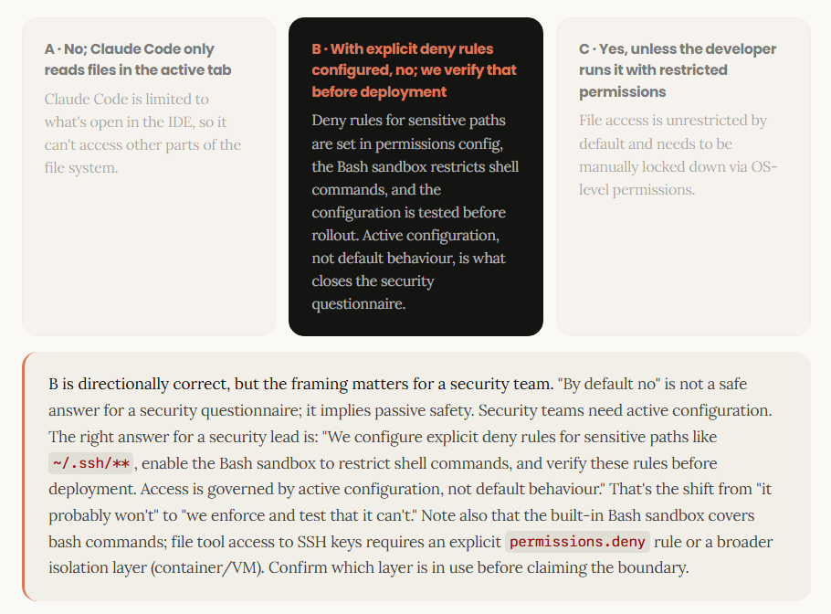

# Installation and environments

## CLI install and prerequisites across OS and platforms

<span style="font-size: 1.25em;">_The install is one command. Getting there is the work._</span>

Before any developer on a client engagement runs Claude Code, you need to confirm the environment. This lesson covers the pre-kickoff checklist you send to IT, the clean install walk-through, and how to diagnose what breaks when something goes wrong.

### Before you begin

**Confirm the environment before install day, not during it!**

Setup failures during a client kickoff are almost always avoidable. The 30-Day Activation Plan is explicit: confirm blockers before kickoff, not at it. This means one short call or checklist exchange with the client's IT team in the week prior.

Three things determine whether install day goes cleanly: whether the target OS is supported, whether the client's network can reach Anthropic's endpoints, and how Claude Code will be authenticated for the developer cohort. All three are answerable in advance, so none require a developer to be present. This is a conversation with IT.

> [!Warning]
> **Engagement principle**
> 
> If install day is the first time you're checking the environment, you're already behind.

### Platform support

<span style="font-size: 1.25em;">_`macOS`, `Linux`, and `Windows` are all natively supported. Windows has two paths._</span>

Most enterprise developer fleets are a mix. Know the Windows options before kickoff so you can advise the client's IT team on which path fits their environment.

#### macOS

Claude Code runs natively on macOS. The install is the same whether developers are on Apple Silicon (M1+) or Intel machines. No additional setup beyond the curl install command. If the team uses a corporate proxy or custom certificate authority, point `NODE_EXTRA_CA_CERTS` at the CA certificate file.

#### Linux

Claude Code runs natively on Linux. Common distributions (Ubuntu 20.04+, Debian 10+, Alpine 3.19+) are all supported. The install is the standard curl command. Like macOS, proxy and certificate handling works through standard environment variables: `HTTPS_PROXY` (or `HTTP_PROXY`) and `NODE_EXTRA_CA_CERTS`.

#### Windows: `Native` Path

Claude Code runs natively on Windows without requiring WSL or any Linux layer. Developers launch it from PowerShell or CMD. Native Windows is the simpler path for most teams, requiring no IT provisioning beyond network access. Git for Windows is optional but recommended; without it, Claude Code uses PowerShell as its shell instead of Git Bash. Confirm with IT before kickoff if this trade-off fits the team's workflow.

### Windows: `WSL` Path

WSL (Windows Subsystem for Linux) is the right choice when the team needs Linux toolchains or wants sandboxing unavailable on native Windows. WSL requires IT enablement on managed machines. If developers choose this path, they install Claude Code inside the WSL environment; it then behaves identically to the Linux install. WSL 2 is recommended for performance and isolation.

### Installation

<span style="font-size: 1.25em;">_One command. What happens after it runs is the part to prepare for._</span>

The install script handles the runtime setup. Authentication is the first decision point after it completes.

The install command varies by OS. On macOS and Linux, use the curl installer. On Windows, use PowerShell (recommended) or CMD.

**macOS and Linux**

```bash
curl -fsSL https://claude.ai/install.sh | bash
```

**Windows (PowerShell, recommended)**

```powershell
irm https://claude.ai/install.ps1 | iex
```

**Windows (CMD)**

```bash
curl -fsSL https://claude.ai/install.cmd -o install.cmd && install.cmd && del install.cmd
```

### Post install authentication

After the install completes, Claude Code opens a terminal prompt asking how the developer wants to authenticate. There are two paths, and the choice shapes your entire cohort setup and whether IT needs to be involved.

#### Browser-based login

The developer presses Enter at the authentication prompt. A browser window opens to a login page where they sign in with their Anthropic account (Team or Enterprise subscription). The browser returns a session token to the terminal, and Claude Code is ready to use. This is the standard path for interactive developers on a Team or Enterprise plan. No IT involvement required for key management; authentication stays at the individual level.

#### API key entry

The developer enters an API key directly at the prompt. This is the standard path for headless use, CI pipelines, or automated workflows, covering any scenario where the developer isn't logging in through a browser. API key distribution requires IT coordination: the key must be created in the Anthropic console, distributed securely (environment variable, secrets vault, or secure file), and rotated periodically. For enterprise cohort deployments where multiple developers share a key, confirm this approach with IT before kickoff: it shapes your provisioning workflow.

### Common Blockers

<span style="font-size: 1.25em">_Four things that go wrong at install time in enterprise environments
Each of these can silently fail or produce misleading errors. Confirm them with the client's IT team before the developer cohort attempts setup._</span>

| | |
| :-- | :-- |
| <span style="font-size: 1.25em">**01**</span><br>**Network access**<br>Claude Code needs to reach Anthropic's API endpoints. On corporate networks with egress filtering, confirm these are reachable before install day: api.anthropic.com (Claude API), claude.ai and platform.claude.com (authentication), downloads.claude.ai (installer and auto-updater), and raw.githubusercontent.com (changelog). This is the first item to raise with IT. Firewall rules take days to change. | <span style="font-size: 1.25em">**02**</span><br>**Proxy and certificate handling**<br>Claude Code respects standard proxy environment variables. Most enterprise setups (Zscaler, CrowdStrike) work without additional configuration if the root certificate is in the OS trust store. Custom CA and mTLS configurations are available if needed. Full proxy setup is covered in Course 3, Lesson 3.3. Confirm with IT that a proxy is in use and flag it as a setup item for that stage. |
| <span style="font-size: 1.25em">**03**</span><br>**Authentication architecture**<br>Confirm the authentication method before kickoff: it shapes your entire cohort setup. For interactive developers on a Team or Enterprise plan, browser-based subscription login is the standard path. API keys are appropriate for CI, headless, or automated use. Mixed cohorts can use both. Confirm IT's involvement and approval for whichever path is chosen before install day. | <span style="font-size: 1.25em">**04**</span><br>**Windows: native vs. WSL on managed machines**<br>Native Windows works without IT involvement. If the team opts into WSL for Linux toolchains or sandboxing, managed IT images may not have it enabled by default and enabling it may require an IT ticket. Establish the Windows path early so you know whether IT involvement is needed. |

### Verification

Confirm the install is clean before moving on
A successful install that hasn't been verified isn't a successful install. It's an assumption.

After installation and authentication, start with a version check to confirm Claude Code is available and responding. Then validate the configuration before the developer cohort onboards.

```bash
# Version check
claude --version
```

If it returns "command not found," the PATH wasn't updated. Close and reopen the terminal or source your shell profile.

```bash
# Configuration validation
claude doctor
```

Run this before the developer cohort onboards. It validates the configuration and lists any invalid settings with their source file and field name: the fastest way to catch a misconfigured policy or proxy before it becomes a support call. Use it as a pre-deployment check on a representative machine before rolling out to the full team.

Once Claude Code is running, use the in-session command `/status` to confirm that proxy and gateway configuration is being applied correctly. Useful when setting up an LLM gateway or corporate proxy for the first time.

## IDE Integrations - VS Code and JetBrains

<span style="font-size: 1.25em;">_VS Code developers have a native panel via the extension. JetBrains developers use a dedicated plugin and run Claude Code from the integrated terminal. By the end of this lesson you'll know which path to recommend to which developer, and the three IDE capabilities worth demonstrating on Day 1._</span>

### The IDE Extensions

VS Code has a native extension, JetBrains has a dedicated plugin, and both give the full capability.
This shapes the setup conversation with a client's IT team and which installation path you walk each developer through.

#### VS Code extension

The VS Code extension (anthropic.claude-code) is the recommended path for VS Code developers. Install it from the VS Code Marketplace (search "Claude Code"), or install directly via `vscode:extension/anthropic.claude-code`. The extension includes the CLI and adds a dedicated Claude Code panel in the IDE.

#### Cursor

For Cursor, use the same extension. It's available at `cursor:extension/anthropic.claude-code` and provides identical functionality to the VS Code version.

#### JetBrains

For JetBrains (IntelliJ, PyCharm, and the rest of the family), two separate installs are required: first install the Claude Code CLI using the installer from Lesson 2.1, then install the Claude Code plugin from the JetBrains Marketplace. The plugin enables IDE integration (diff viewing, selection context, file references, diagnostics); the CLI provides the Claude Code engine. Both must be installed for the full experience.

### Running sessions

Run `claude` from the integrated terminal to start a session. For a mixed cohort, this means two setup paths: VS Code and Cursor developers install the VS Code extension; JetBrains developers install both the CLI and the plugin.

> <small><span style="color: #d97757">THE FRAMING</span></small>
>
> <span style="font-size: 1.15em;">_Two entry points, same engine. <span style="color: #d97757">Match the entry point to the developer's IDE._</span></span>

### What's different

<span style="font-size: 1.25em;">_Three capabilities that change how developers experience Claude Code in the IDE_</span>

These are the moments that shift a developer's perception from "CLI tool" to "integrated into my workflow." Demonstrate all three on Day 1.

| | | |
| :-- | :-- | :-- |
| <span style="font-size: 1.25em">**01**</span><br><br>**Diff viewing**<br><br>Code changes appear in the IDE's native diff viewer, not as terminal output. Developers see exactly what Claude Code changed, side by side, in the interface they already use for code review. Configurable via `/config`. | <span style="font-size: 1.25em">**02**</span><br><br>**Selection context**<br><br>The current selection and open tab are automatically shared with Claude Code. A developer can highlight a function, type a prompt, and Claude Code already knows what they're talking about, without needing to specify the file or paste the code. | <span style="font-size: 1.25em">**03**</span><br><br>**File reference shortcuts**<br><br>The `@app.ts#5–10` pattern pulls specific files and line ranges directly into the conversation. Insert the reference with `Option+K` (Mac) or `Alt+K` (Windows/Linux) in the VS Code extension, or `Cmd+Option+K` (Mac) / `Alt+Ctrl+K` (Windows/Linux) in JetBrains. Faster than copy-pasting, and keeps the reference precise rather than approximate. |

### Supported environments

<span style="font-size: 1.25em;">_VS Code, JetBrains, and the forks question_</span>

Client dev teams use a mix of editors. Know the answer to the forks question before they ask it.

| | |
| :-- | :-- |
| <small>**VS CODE FAMILY**</small><br><br>**VS Code and Cursor: install the extension**<br><br>The `anthropic.claude-code` extension is the recommended path for VS Code. Install via the Marketplace (Cmd/Ctrl+Shift+X, search "Claude Code") or use `vscode:extension/anthropic.claude-code`. For Cursor, use `cursor:extension/anthropic.claude-code`. Other VS Code forks (e.g., Devin Desktop, Kiro) can install the extension from the Open VSX registry or the Extensions view. The same extension works across all VS Code-compatible editors. | <small>**JETBRAINS FAMILY**</small><br><br>**IntelliJ, PyCharm, and other JetBrains IDEs: install the plugin**<br><br>**Both the CLI and the plugin are required.** Install the Claude Code CLI first (using the installer from Lesson 2.1), then install the Claude Code plugin from the JetBrains Marketplace. Run `claude` from the integrated terminal. The plugin enables diff viewing, selection context, and file reference shortcuts; it does not include the Claude Code engine. Flag to the client's IT team that the integrated terminal must be enabled (on some enterprise configurations it may be restricted by default) and that the plugin requires a full IDE restart after installation. |

### Configuration

<span style="font-size: 1.25em;">_IDE-relevant settings live in `/config`_</span>

Diff viewing defaults to `auto`, but developers can adjust IDE behavior without leaving the terminal.

Running `/config` inside a Claude Code session opens the configuration menu. From here, developers can toggle whether code changes open in the IDE diff viewer, adjust verbosity, and set other session-level preferences. This is worth demonstrating early: it gives client developers a sense of agency over the tool, and it surfaces the preference most likely to generate questions ("why is it showing diffs in a separate tab?").

`/config` opens a tabbed settings interface (not a CLI flag set, but an interactive menu inside the session). Settings can exist at multiple levels: enterprise managed settings (if deployed by the organisation), command-line flags, local project `.claude/settings.json`, and user-level `~/.claude/settings.json`. For enterprise deployments, confirm which level owns the setting and whether users can override it. The settings most relevant to IDE integration are typically at the user level:

#### Auto-connect to IDE

Automatically connects to an IDE when Claude Code is launched from an external terminal. Toggle: `autoConnectIde`

#### Auto-install IDE extension

Installs the IDE extension automatically on first connect. Toggle: `autoInstallIdeExtension`

#### Show last response in external editor

Surfaces Claude's last response in a read-only editor panel. Toggle: `externalEditorContext`

#### Editor mode

Key binding mode for the input prompt: normal or vim. Toggle: `editorMode`

For the full list of available settings and their current defaults, direct developers to the [Claude Code documentation](https://docs.claude.com/). The `/config` menu is interactive and updates with each Claude Code release, so the documentation reflects the most current options.

### Engagement scenario

<span style="font-size: 1.25em;">_A developer asks about their editor_</span>

You're running the Claude Code kickoff session. One of the client's developers raises their hand.

> <small>Decision · Scenario</small>
>

> A developer says: <small>`"I use Cursor, not VS Code. Most of the team is on VS Code but I switched last year. Will Claude Code work for me, or do I need to go back to VS Code?"`</small> What do you tell them?
><br/>

| | | |
| :-- | :-- | :-- |
| **A · Cursor isn't supported; they'll need VS Code**<br><br>Redirect them to install VS Code for a consistent team experience. | **B · Cursor is supported, same setup as VS Code**<br><br>VS Code forks including Cursor are supported. Install the extension at `cursor:extension/anthropic.claude-code`, same as the VS Code path. | **C · Cursor might work, but check with IT first**<br><br>Flag it as unsupported until confirmed, to avoid inconsistencies in the team setup. |

## Teminal Patterns and Shell Setup

<span style="font-size: 1.25em;">_By the end of this lesson you'll know which terminal patterns to demonstrate on Day 1, which ones to teach in week two, and how to feed real data into Claude Code via the shell. This pattern bridges interactive use and the CI pipelines in Lesson 2.5._</span>

### Before first use

<span style="font-size: 1.15em;">_The authentication variable that most silently blocks a first run_</span>

The authentication method for a client deployment depends on architecture. Confirm it before the first developer session, not during it.

#### Authentication methods

Interactive developers on a Team or Enterprise plan typically authenticate via browser-based subscription login. API keys are the standard for CI, headless, and automated workflows. Cloud-provider routing (Bedrock, Vertex AI) is a third path for clients who deploy through AWS or GCP. When an API key is used, it goes in the developer's shell profile (`~/.zshrc` or `~/.bashrc` on most client machines) or, for headless and CI environments, in a secrets store (covered in Lesson 2.5). When set, `ANTHROPIC_API_KEY` overrides subscription login.

When enabling multiple developers at once, confirm key distribution with IT in advance. Walking into an enablement session without knowing whether keys have been provisioned costs time that doesn't come back.

#### Environment variables

Many environment variables govern authentication, network routing, governance, and runtime behaviour. You don't need to teach all of them on Day 1. When a deployment silently blocks authentication or network traffic, you'll know where to look. Six of the most scenario-relevant ones are below.


#### Reference Environment Variables

| VARIABLE | CATEGORY | WHAT IT DOES |
| :-- | :-- | :-- |
| `ANTHROPIC_API_KEY` | Auth | API key for authentication. Optional for interactive use when subscription login is available. Required for headless, CI, or API-key-only deployments. When set, overrides subscription login. |
| `ANTHROPIC_AUTH_TOKEN` | Auth | Custom bearer token for the `Authorization` header. Often used with gateways, managed auth, or externally provisioned credentials. Takes precedence over `ANTHROPIC_API_KEY`. |
| `ANTHROPIC_BASE_URL` | Deployment | Redirect Claude API traffic to an LLM gateway or corporate proxy. Points at your gateway's Anthropic-format endpoint. |
| `CLAUDE_CODE_USE_BEDROCK` | Deployment | Route model traffic through Amazon Bedrock instead of the Anthropic API. Set to `1` to enable. |
| `CLAUDE_CODE_USE_VERTEX` | Deployment | Route model traffic through Google Vertex AI. Requires `ANTHROPIC_VERTEX_PROJECT_ID` and `CLOUD_ML_REGION`. |
| `ANTHROPIC_BEDROCK_BASE_URL` | Deployment | Override the Bedrock endpoint. Typically used to route Bedrock traffic through an LLM gateway. |
| `HTTPS_PROXY` / `HTTP_PROXY` | Network | Corporate proxy server URL. Use `HTTPS_PROXY` first; fall back to `HTTP_PROXY` if unavailable. Credentials can be embedded in the URL. |
| `NO_PROXY` | Network | Comma-separated or space-separated list of hosts to bypass the proxy. Set to `*` to bypass for all requests. |
| `NODE_EXTRA_CA_CERTS` | Network | Path to a custom CA certificate file. Required when the corporate network uses a CA not in the OS trust store (e.g. a self-signed TLS inspection cert). |
| `CLAUDE_CODE_CERT_STORE` | Network | Controls which CA certificate store Claude Code trusts. Values: `bundled,system` (default), `bundled`, or `system`. |
| `CLAUDE_CODE_CLIENT_CERT` | Network | Path to a client certificate for mTLS authentication. Pair with `CLAUDE_CODE_CLIENT_KEY`. |
| `DISABLE_TELEMETRY` | Governance | Disables telemetry reporting. Use in environments where outbound telemetry traffic is restricted by policy. |
| `CLAUDE_CODE_DISABLE_NONESSENTIAL_TRAFFIC` | Governance | Suppresses non-essential outbound traffic (telemetry, changelog fetches, etc.). Useful for air-gapped or restricted-egress environments. |
| `DISABLE_AUTOUPDATER` | Governance | Prevents Claude Code from auto-updating. Appropriate when the client manages software versions centrally or needs to pin a specific version for stability. |
| `CLAUDE_CODE_MAX_TURNS` | Behavior | Maximum number of agentic turns before Claude Code stops and asks for confirmation. Useful for cost control during a pilot. Works alongside permission settings. |

### Working in the terminal

<span style="font-size: 1.15em;">_Four categories of shortcuts: teach them in this order
Not all shortcuts are equal. Some change the interaction model; some are housekeeping. Sequence matters when you're enabling a client team who is already overloaded on Day 1._</span>

| | |
| :-- | :-- |
| <small>**BASH MODE**</small><br><br>`!` **prefix**<br><br>Runs a shell command directly. The command output is shown to Claude Code, so you can reference it in the next prompt. Faster than asking Claude to run a known command. Teach this first. It's the shortcut that changes how developers think about the tool. | <small>**CONTEXT MANAGEMENT**</small><br><br>`/clear` `/compact` `/context`<br><br>**/clear** resets the conversation (not the files). **/compact** condenses context to save space without losing the thread. **/context** visualises how much context window is in use.<br><br>**Recommended teaching sequence:** Introduce these in week two, after developers have hit a context limit and asked why the model seems to be forgetting things. |
| <small>**NAVIGATION**</small><br><br>`Esc` `Esc Esc` `Shift+Tab`<br><br>**Esc** cancels the current action mid-run. **Esc Esc** opens a rewind menu — Fork conversation, Rewind code, or Fork + Rewind — when the input is empty. If the input contains text, Esc Esc clears the draft instead. **Shift+Tab** cycles through three execution modes:<br><br>• **default: standard behaviour**<br>• **auto-accept edits: applies changes without prompting**<br>• **plan: presents proposed changes and waits for approval before executing**<br><br>Plan mode is the one that matters for enterprise clients with strict code review requirements. | <small>**FILE CONTEXT AND SESSION**</small><br><br>`@` `--continue` `/model`<br><br>**@** adds a file or folder to context by path. **--continue** (or **-c**) resumes the most recent conversation when starting a new Claude Code session from the shell; **--resume \<session-id\>** resumes a specific one. These are CLI flags, not slash commands. Use them when starting Claude Code, not inside an active session.<br><br>**/model** switches the underlying model mid-session without restarting. Remember: Teach when relevant to maximize impact rather than Day 1 with everything else. |

### Bash mode

<span style="font-size: 1.15em;">_Teach bash mode first: it shifts how developers see the tool_</span>

Your developers will see Claude Code as an extension of their terminal, not a separate system. That shift happens on Day 1 when you teach the `!` prefix.

**Why this matters for your developers:** Without bash mode, asking Claude Code to run a test or build command means Claude decides what to run, the developer waits for output, then pastes it back. With bash mode, developers type the command they already know, it runs immediately, and the output is already in Claude's context. No intermediary step. That efficiency changes the engagement from `"let's try this AI tool"` to `"this fits how I work."`

**How bash mode works:** The `!` (bang!) prefix tells Claude Code to run a shell command directly without interpretation. The command and its output are visible to Claude in the next prompt, so developers can immediately follow up and reference what was printed, with no copy-pasting required.

```bash
# Run a command directly — output goes to Claude's context
! npm test

# Now ask Claude about the output — it already saw it
Fix the failing tests in the output above
```

### Shell patterns

<span style="font-size: 1.15em;">_Piping data into Claude Code: the bridge to CI automation_</span>

Shell piping works with Claude Code the same way it works with any Unix command. The patterns here are the building blocks you'll use again in Lesson 2.5 when setting up client CI pipelines.

**Use the pipe operator to send any shell output directly to Claude Code as the prompt input.** This works for log files, git diffs, PR output, error messages. Anything the shell can produce, Claude Code can consume. Combined with the `-p` flag for non-interactive use, these become the pipeline patterns in Lesson 2.5.

```bash
# Pass a log file to Claude for analysis
cat error.log | claude

# Pipe a PR diff for a security review
gh pr diff "$1" | claude -p --append-system-prompt "Review for security vulnerabilities"

# Pass git log output for a summary
git log --oneline -20 | claude -p "Summarise these commits for a release note"
```

## Development containers & sandboxed execution

<span style="font-size: 1.25em;">_When a client's IT security team asks what Claude Code can access, the answer depends on which isolation boundary is in place. This lesson covers the isolation options, what each one covers, and how to configure them, so you can answer security questionnaires accurately, not optimistically._</span>

### The security case

<span style="font-size: 1.15em;">_Isolation has layers. "It's sandboxed" is not a complete security answer._</span>

On enterprise engagements, the question of what Claude Code can access (and what it can't) will come up in the security review. The correct answer is not `"sandboxed"`; it's `"depends on which isolation layer is in place."`

Claude Code offers multiple isolation options, each covering different access surfaces. The built-in Bash sandbox restricts Bash subprocesses and child processes, but it does not restrict Claude Code's _built-in_ file tools, MCP servers, hooks, or web access. Those surfaces require additional isolation: a sandbox runtime, a dev container, or a VM. When IT asks `"what can Claude Code access?"`, the honest answer is: `"depends on the isolation boundary we configure."` That's what this lesson covers.

| ACCESS SURFACE | BUILT-IN BASH SANDBOX | SANDBOX RUNTIME | CONTAINER / VM |
| :--- | :--- | :--- | :--- |
| Bash commands |  Restricted |  Restricted |  Restricted |
| File tools (Read/Write) |  Full access |  Restricted |  Restricted |
| MCP servers |  Full access |  Full access |  Restricted |
| Hooks |  Full access |  Full access |  Restricted |
| Web access |  Full access |  Restricted |  Restricted |

### The controls

<span style="font-size: 1.15em;">_Four properties of Claude Code's sandboxing model_</span>

Each of these is a talking point in a security questionnaire conversation, and a configuration decision before deployment.

| | |
| :--- | :--- |
| <span style="font-size: 1.25em;">01</span><br><br>**Directory scoping**<br><br>Claude Code can be restricted to specific directories. It cannot read or write outside the defined scope. For a developer working in a project directory, this means Claude Code stays inside the project. It cannot access the developer's home directory, other codebases, or system files unless explicitly permitted. | <span style="font-size: 1.25em;">02</span><br><br>**Network allowlisting**<br><br>Outbound network requests from Claude Code can be constrained to a defined allowlist of hosts. Attempts to reach endpoints outside the allowlist are blocked. This is particularly relevant in regulated industries where data exfiltration controls are part of the security posture. |
| <span style="font-size: 1.25em;">03</span><br><br>**Approval-free operation within bounds**<br><br>Operations inside the defined sandbox proceed without interrupting the developer for confirmation. This preserves the productivity benefit: developers aren't approving every file read or every shell command, while the scope of autonomous action stays explicitly bounded. | <span style="font-size: 1.25em;">04</span><br><br>**Out-of-sandbox notification**<br><br>When Claude Code attempts an operation outside the sandbox boundary, it surfaces the attempt rather than silently failing or silently escalating. The developer sees what was attempted and can decide whether to expand the sandbox or redirect the approach. This is the transparency property: it's what makes the boundary meaningful rather than opaque. |

### Configuration

<span style="font-size: 1.15em;">_Sandbox configuration lives in `settings.json`: three field groups to know_</span>

Sandbox controls are configured declaratively. A minimal working example covers most enterprise requirements in under 20 lines.

Sandbox configuration for Claude Code is managed through `settings.json`, either at the user level (`~/.claude/settings.json`) or deployed via managed settings for a team. Three field groups do the work: sandbox (process isolation and filesystem bounds), permissions (tool-level allow/deny rules), and network (outbound domain allowlisting). Here's a minimal configuration that covers a typical enterprise hardening requirement:

```json
{
  "sandbox": {
    "enabled": true,
    "filesystem": {
      "denyRead": ["/"],
      "allowRead": ["/project", "~/.claude"],
      "allowWrite": ["/project"]
    },
    "network": {
      "allowedDomains": [
        "api.anthropic.com",
        "*.client-internal.com"
      ]
    }
  },
  "permissions": {
    "allow": [
      "Bash(npm run test *)",
      "Bash(npm run lint)",
      "Read(/project/**)"
    ],
    "deny": [
      "Bash(curl *)",
      "Read(./.env)",
      "Read(~/.ssh/**)"
    ],
    "defaultMode": "acceptEdits"
  }
}
```

Key fields to know for the security questionnaire conversation:

| | |
| :--- | :--- |
| **sandbox.filesystem.denyRead / allowRead**<br><br>Sets the directory boundary. Deny the root, then re-allow the project directory. This is what lets you tell the security team "it can't read SSH keys" rather than "it probably won't." | **sandbox.network.allowedDomains**<br><br>Outbound domain allowlist. Wildcards are supported (`*.client-internal.com`). Set this to enforce egress policy rather than relying on firewall rules alone. |
| **permissions.deny**<br><br>Tool-level deny rules. Block specific bash patterns (`curl *`) or file access (`Read(./.env)`). These rules cannot be overridden by local config when deployed in managed settings. | **permissions.defaultMode**<br><br>Default permission mode on launch. Options: `default`, `acceptEdits`, `plan`, `auto`. Use `acceptEdits` for teams that want edits to auto-approve while still confirming bash commands. |

### Dev containers

<span style="font-size: 1.15em;">_Running Claude Code inside a container adds an outer boundary to the inner one_</span>

A dev container is the natural complement to sandbox configuration for enterprise clients who want reproducible, isolated developer environments.

When Claude Code runs inside a dev container, the container itself provides a second layer of isolation. The file system, network, and process scope are all bounded by the container definition before Claude Code's own sandbox controls apply. For client security teams, this is a strong answer to questions about isolation: both the tool and the environment are constrained. Anthropic provides an official dev container feature that handles the Claude Code install automatically.

> <small>devcontainer.json: Claude Code feature</small>
>
> ```json
> {
>   "image": "mcr.microsoft.com/devcontainers/base:ubuntu",
>   "features": {
>     "ghcr.io/anthropics/devcontainer-features/claude-code:1.0": {}
>   }
> }
> ```

The feature version pins the install script, not the Claude Code release. Claude Code auto-updates inside containers by default unless auto-update is disabled via `DISABLE_AUTOUPDATER`. For environments with pinned version policies, set this variable explicitly. Full devcontainer documentation is at [code.claude.com/docs/en/devcontainer](code.claude.com/docs/en/devcontainer).

### Engagement scenario

**The security questionnaire question**

You're on a call with the client's IT security lead, walking through the Claude Code deployment plan.

> [!Note]
> <small>Decision · Scenario</small>
>
> The security lead asks: <small>`"Could a developer accidentally configure Claude Code to read files outside their project directory, say their SSH keys or credentials in their home folder?"`</small> What do you tell them?



## Headless and non-interactive mode for scripted and CI use

<span style="font-size: 1.25em;">_Once a client team has Claude Code running interactively, the next question is always the same: can we automate this? By the end of this lesson you'll know the flags, the patterns, and the GitHub Actions integration, and be ready to design a headless Claude Code workflow for a real engagement._</span>

### The concept

<span style="font-size: 1.15em;">_The `-p` flag is the on/off switch for pipeline use._</span>

Headless mode is not a separate product or a different tool. It's a flag. That simplicity is worth emphasising to a client team who assumes a CI integration means a new deployment to manage.

Adding `-p` to the Claude Code command makes it run non-interactively: it takes the prompt from the command line argument, executes, and exits. No waiting for input, no interactive session. This is what makes Claude Code composable with shell scripts, CI pipelines, pre-commit hooks, and any automated workflow. The same binary, the same authentication, the same model, just invoked without a human in the loop.

### Key flags

<span style="font-size: 1.15em;">_Five flags that shape every headless workflow_</span>

Most headless Claude Code commands on an engagement use some combination of these five. Know what each one controls and when to reach for it.

|  | |
| :---: | :--- |
| <span style="font-size: 1.25em; font-weight: bold;">1</span> | `-p` : **Non-interactive mode**<br><br>Runs Claude Code without an interactive session, making it required for any pipeline use. Takes the prompt as a string argument: `claude -p "Your prompt here"`. Use this any time Claude Code runs in a script or automated workflow. |
| <span style="font-size: 1.25em; font-weight: bold;">2</span> | `--allowedTools` : **Tool restriction**<br><br>Restricts which tools Claude Code can use in this execution. Pass a comma-separated list: `--allowedTools "Bash,Read,Edit"`. Use this when the pipeline should be limited: a code review that reads files but doesn't execute shell commands, for example. |
| <span style="font-size: 1.25em; font-weight: bold;">3</span> | `--append-system-prompt` : **Pipeline instructions**<br><br>Injects a system-level instruction that applies to this execution. Use this to set the context for an automated task: "this is a security review", "always output in JSON", "focus only on the changed files". It's how you specialise the same tool for different pipeline stages. |
| <span style="font-size: 1.25em; font-weight: bold;">4</span> | `--output-format json` : **Structured output**<br><br>Outputs Claude Code's response as JSON rather than prose. Essential when the output feeds into another system: a dashboard, a ticket, a database. Specify the expected schema in the prompt itself: *"Output a JSON array where each item has 'path' (string) and 'method' (string)."* For workflows requiring strict schema conformance, implement retry logic and validate output format in your pipeline. Test schema compliance in a controlled run before deploying to production. |
| <span style="font-size: 1.25em; font-weight: bold;">5</span> | `--bare` : **Reproducible CI mode**<br><br>Disables local hooks, skills, plugins, MCP servers, auto memory, and CLAUDE.md loading for this execution. Use when you need consistent behaviour across environments: the same command produces the same result regardless of what's configured on any individual developer's machine. Combine with `-p` for fully isolated, reproducible CI workflows: `claude -p --bare 'Your prompt here'`. |

### In practice

<span style="font-size: 1.15em;">_Three patterns to show a client team, each from a real use case_</span>

These patterns come directly from the source material. They're functional, not illustrative: show them running, not just described.

| | | |
| :--- | :--- | :--- |
| <span style="font-size: 1.25em;">01</span><br><br>**Automated code review**<br><br>Pipes a PR diff into Claude Code with a security review system prompt. The output is JSON, suitable for posting back to the PR or feeding into a dashboard. | <span style="font-size: 1.25em;">02</span><br><br>**Test-and-fix loop**<br><br>Runs the test suite and instructs Claude Code to fix failures. Limits tool access to the operations needed, with no extraneous permissions. Stops after the test run regardless of outcome. | <span style="font-size: 1.25em;">03</span><br><br>**Structured extraction**<br><br>Extracts structured information from a codebase (API endpoints, dependencies, configuration values) and outputs it as JSON with a specified structure that downstream tooling can parse directly. Schema is defined in the prompt. |

```bash
# Pattern 1: Automated code review on a PR
gh pr diff "$1" | claude -p \
  --append-system-prompt "Review for security vulnerabilities" \
  --output-format json

# Pattern 2: Run tests and fix failures
claude -p "Run test suite, fix any failures" \
  --allowedTools "Bash,Read,Edit"

# Pattern 3: Structured output — list API endpoints
claude -p 'List all API endpoints in this codebase. Output a JSON array where each item has "path" (string) and "method" (string).' \
  --output-format json
```

### CI/CD integration

**GitHub Actions:** the setup is two steps and a trigger
The client's development team almost certainly already uses GitHub Actions. Integrating Claude Code is an addition to their existing workflow, not a replacement.

To set up Claude Code in GitHub Actions, run `/install-github-app` from an active Claude Code session. This installs the GitHub app to the client's organisation. Once installed, developers can trigger Claude Code on any issue or PR by tagging `@claude` in a comment. Claude Code reads the context and responds, with no manual pipeline configuration required for the basic case.

#### For custom pipeline workflows

Custom workflows automate Claude Code without waiting for a developer to tag `@claude`. A custom workflow YAML has four building blocks:

| | |
| :-- | :-- |
| **01 TRIGGER**<br><br>On every pull request, on schedule, or on a custom event | **02 ENVIRONMENT**<br><br>ANTHROPIC_API_KEY injected from GitHub Secrets |
| **03 CLAUDE COMMAND**<br><br>Flags for task, output format: `-p` (non-interactive), `--output-format json`, `--allowedTools` | **04 OUTPUT HANDLING**<br><br>Post results as PR comment, save to file, or pipe to another action |

Unlike the basic `@claude` trigger where Claude Code reads PR context and responds in prose, custom workflows define the exact task, the structure of the response, and where the response goes.

### Headless auth

<span style="font-size: 1.15em;">_Authentication in CI is a secrets management question, not a Claude Code question._</span>

The mechanism is the same as any API credential in a pipeline. The configuration varies by CI platform.

Headless Claude Code authenticates via `ANTHROPIC_API_KEY`, without a browser or interactive login. In GitHub Actions, this means adding the key as a repository or organisation secret and referencing it in the workflow YAML with `${{ secrets.ANTHROPIC_API_KEY }}`. The same pattern applies in GitLab CI (CI/CD variables), Jenkins (credentials store), and other platforms. The client's DevOps team will recognise this pattern immediately: it's exactly how they handle any other API key in their pipelines.

#### Engagement scenario

<span style="font-size: 1.15em;">_Designing the right pipeline command_</span>

A client's engineering lead is designing an automated PR review workflow.

> 🙋‍♀️ <small>Decision · Scenario</small>
>
> The lead says: <small>`"We want Claude Code to review every PR automatically and output a structured JSON report that our internal security dashboard can consume. What's the right combination of flags?"`</small>

| | | |
| :-- | :-- | :-- |
| **A ·** `-p` **only**<br><br>The -p flag handles both the non-interactive execution and the output format.[cite: 5]| **B ·** `--json-schema` **only**<br><br>The schema flag is enough to make Claude Code output structured JSON.[cite: 5]| 👍 **C ·** `-p` **+** `--output-format json` **+ schema in the prompt**<br><br>Non-interactive execution and JSON output format as flags, with the schema defined in the prompt text itself.[cite: 5]|
| **D ·** `-p` **+** `--allowedTools`<br><br>Headless mode plus tool restriction handles the structured output requirement.[cite: 5]| | |
| | | |

| |
| :-- |
| 👍 **C is correct.** Two flags, each doing a distinct job, plus prompt design: -p makes it non-interactive (runs without waiting for input); `--output-format json` tells Claude Code to output JSON rather than prose; and the expected structure (fields, types, nesting) is specified in the prompt itself. Schema guidance in the prompt shapes the output, but for production pipelines, build in validation and retry logic; don't assume the shape will always match exactly. Using `--output-format json` alone without specifying structure in the prompt leaves the JSON shape undefined: the dashboard won't know what to parse.[cite: 5]|
| |

### Practice

<span style="font-size: 1.15em;">_Install and run across three environments_</span>

You've learned the pieces. Now assemble them.

**Environment 1: CLI (Local)**

From Lesson 2.1, you know the install sequence and can verify it with `claude --version`. Run this first.

**Environment 2: IDE Integration**

From Lesson 2.2, install the IDE extension (VS Code or JetBrains). Open a small file, ask Claude Code a question about it, and verify the response appears inline. You're not running a headless command here; you're checking that the IDE integration works as an interactive tool.

**Environment 3: Dev Container**

This requires setup not covered in Course 2. You'll need to: (1) create a devcontainer.json or Docker config that includes Claude Code, (2) start the container, and (3) verify `claude --version` works inside it. Refer to your container platform's documentation and the Claude Code CLI reference for installation steps. The isolation concepts from Lesson 2.4 apply here: the container is the sandbox.

**Headless Script: End-to-End Run**

From Lesson 2.5, you know the `-p` flag runs Claude Code non-interactively. Create a simple test script:

```bash
echo "What does this function do?" | claude -p --stdin --output-format text
```

Run this from your CLI environment (Environment 1). What you're verifying: (1) the prompt reaches Claude Code, (2) Claude Code runs without waiting for input (-p flag), (3) output appears. Then run the same command from inside your dev container (Environment 3). Success is when both produce output.

**Success Criteria**

* `claude --version` returns a version string in all three environments.
* IDE extension loads without errors and responds to a simple query.
* The headless `-p` command produces output in both CLI and container contexts.

What you'll learn by doing this: Why dev containers are a client advantage (reproducible, isolated, version-locked), what "headless" actually means in practice (non-interactive execution that powers CI pipelines), and where the gaps are in your environment (usually authentication in containers or shell context).