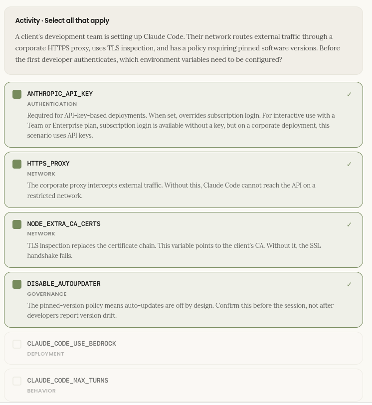

# Installation and environments

## CLI install and prerequisites across OS and platforms


<span style="font-size: 1.25em;">_The install is one command. Getting there is the work._</span>

Before any developer on a client engagement runs Claude Code, you need to confirm the environment. This lesson covers the pre-kickoff checklist you send to IT, the clean install walk-through, and how to diagnose what breaks when something goes wrong.

### Before you begin

**Confirm the environment before install day, not during it!**

Setup failures during a client kickoff are almost always avoidable. The 30-Day Activation Plan is explicit: confirm blockers before kickoff, not at it. This means one short call or checklist exchange with the client's IT team in the week prior.

Three things determine whether install day goes cleanly: whether the target OS is supported, whether the client's network can reach Anthropic's endpoints, and how Claude Code will be authenticated for the developer cohort. All three are answerable in advance, so none require a developer to be present. This is a conversation with IT.

> [!Warning]
> **Engagement principle**
> 
> If install day is the first time you're checking the environment, you're already behind.

### Platform support

<span style="font-size: 1.25em;">_`macOS`, `Linux`, and `Windows` are all natively supported. Windows has two paths._</span>

Most enterprise developer fleets are a mix. Know the Windows options before kickoff so you can advise the client's IT team on which path fits their environment.

#### macOS

Claude Code runs natively on macOS. The install is the same whether developers are on Apple Silicon (M1+) or Intel machines. No additional setup beyond the curl install command. If the team uses a corporate proxy or custom certificate authority, point `NODE_EXTRA_CA_CERTS` at the CA certificate file.

#### Linux

Claude Code runs natively on Linux. Common distributions (Ubuntu 20.04+, Debian 10+, Alpine 3.19+) are all supported. The install is the standard curl command. Like macOS, proxy and certificate handling works through standard environment variables: `HTTPS_PROXY` (or `HTTP_PROXY`) and `NODE_EXTRA_CA_CERTS`.

#### Windows: `Native` Path

Claude Code runs natively on Windows without requiring WSL or any Linux layer. Developers launch it from PowerShell or CMD. Native Windows is the simpler path for most teams, requiring no IT provisioning beyond network access. Git for Windows is optional but recommended; without it, Claude Code uses PowerShell as its shell instead of Git Bash. Confirm with IT before kickoff if this trade-off fits the team's workflow.

### Windows: `WSL` Path

WSL (Windows Subsystem for Linux) is the right choice when the team needs Linux toolchains or wants sandboxing unavailable on native Windows. WSL requires IT enablement on managed machines. If developers choose this path, they install Claude Code inside the WSL environment; it then behaves identically to the Linux install. WSL 2 is recommended for performance and isolation.

### Installation

<span style="font-size: 1.25em;">_One command. What happens after it runs is the part to prepare for._</span>

The install script handles the runtime setup. Authentication is the first decision point after it completes.

The install command varies by OS. On macOS and Linux, use the curl installer. On Windows, use PowerShell (recommended) or CMD.

**macOS and Linux**

```bash
curl -fsSL https://claude.ai/install.sh | bash
```

**Windows (PowerShell, recommended)**

```powershell
irm https://claude.ai/install.ps1 | iex
```

**Windows (CMD)**

```bash
curl -fsSL https://claude.ai/install.cmd -o install.cmd && install.cmd && del install.cmd
```

### Post install authentication

After the install completes, Claude Code opens a terminal prompt asking how the developer wants to authenticate. There are two paths, and the choice shapes your entire cohort setup and whether IT needs to be involved.

#### Browser-based login

The developer presses Enter at the authentication prompt. A browser window opens to a login page where they sign in with their Anthropic account (Team or Enterprise subscription). The browser returns a session token to the terminal, and Claude Code is ready to use. This is the standard path for interactive developers on a Team or Enterprise plan. No IT involvement required for key management; authentication stays at the individual level.

#### API key entry

The developer enters an API key directly at the prompt. This is the standard path for headless use, CI pipelines, or automated workflows, covering any scenario where the developer isn't logging in through a browser. API key distribution requires IT coordination: the key must be created in the Anthropic console, distributed securely (environment variable, secrets vault, or secure file), and rotated periodically. For enterprise cohort deployments where multiple developers share a key, confirm this approach with IT before kickoff: it shapes your provisioning workflow.

### Common Blockers

<span style="font-size: 1.25em">_Four things that go wrong at install time in enterprise environments
Each of these can silently fail or produce misleading errors. Confirm them with the client's IT team before the developer cohort attempts setup._</span>

| | |
| :-- | :-- |
| <span style="font-size: 1.25em">**01**</span><br>**Network access**<br>Claude Code needs to reach Anthropic's API endpoints. On corporate networks with egress filtering, confirm these are reachable before install day: api.anthropic.com (Claude API), claude.ai and platform.claude.com (authentication), downloads.claude.ai (installer and auto-updater), and raw.githubusercontent.com (changelog). This is the first item to raise with IT. Firewall rules take days to change. | <span style="font-size: 1.25em">**02**</span><br>**Proxy and certificate handling**<br>Claude Code respects standard proxy environment variables. Most enterprise setups (Zscaler, CrowdStrike) work without additional configuration if the root certificate is in the OS trust store. Custom CA and mTLS configurations are available if needed. Full proxy setup is covered in Course 3, Lesson 3.3. Confirm with IT that a proxy is in use and flag it as a setup item for that stage. |
| <span style="font-size: 1.25em">**03**</span><br>**Authentication architecture**<br>Confirm the authentication method before kickoff: it shapes your entire cohort setup. For interactive developers on a Team or Enterprise plan, browser-based subscription login is the standard path. API keys are appropriate for CI, headless, or automated use. Mixed cohorts can use both. Confirm IT's involvement and approval for whichever path is chosen before install day. | <span style="font-size: 1.25em">**04**</span><br>**Windows: native vs. WSL on managed machines**<br>Native Windows works without IT involvement. If the team opts into WSL for Linux toolchains or sandboxing, managed IT images may not have it enabled by default and enabling it may require an IT ticket. Establish the Windows path early so you know whether IT involvement is needed. |

### Verification

Confirm the install is clean before moving on
A successful install that hasn't been verified isn't a successful install. It's an assumption.

After installation and authentication, start with a version check to confirm Claude Code is available and responding. Then validate the configuration before the developer cohort onboards.

```bash
# Version check
claude --version
```

If it returns "command not found," the PATH wasn't updated. Close and reopen the terminal or source your shell profile.

```bash
# Configuration validation
claude doctor
```

Run this before the developer cohort onboards. It validates the configuration and lists any invalid settings with their source file and field name: the fastest way to catch a misconfigured policy or proxy before it becomes a support call. Use it as a pre-deployment check on a representative machine before rolling out to the full team.

Once Claude Code is running, use the in-session command `/status` to confirm that proxy and gateway configuration is being applied correctly. Useful when setting up an LLM gateway or corporate proxy for the first time.

## IDE Integrations - VS Code and JetBrains

<span style="font-size: 1.25em;">_VS Code developers have a native panel via the extension. JetBrains developers use a dedicated plugin and run Claude Code from the integrated terminal. By the end of this lesson you'll know which path to recommend to which developer, and the three IDE capabilities worth demonstrating on Day 1._</span>

### The IDE Extensions

VS Code has a native extension, JetBrains has a dedicated plugin, and both give the full capability.
This shapes the setup conversation with a client's IT team and which installation path you walk each developer through.

#### VS Code extension

The VS Code extension (anthropic.claude-code) is the recommended path for VS Code developers. Install it from the VS Code Marketplace (search "Claude Code"), or install directly via `vscode:extension/anthropic.claude-code`. The extension includes the CLI and adds a dedicated Claude Code panel in the IDE.

#### Cursor

For Cursor, use the same extension. It's available at `cursor:extension/anthropic.claude-code` and provides identical functionality to the VS Code version.

#### JetBrains

For JetBrains (IntelliJ, PyCharm, and the rest of the family), two separate installs are required: first install the Claude Code CLI using the installer from Lesson 2.1, then install the Claude Code plugin from the JetBrains Marketplace. The plugin enables IDE integration (diff viewing, selection context, file references, diagnostics); the CLI provides the Claude Code engine. Both must be installed for the full experience.

## Running sessions

Run `claude` from the integrated terminal to start a session. For a mixed cohort, this means two setup paths: VS Code and Cursor developers install the VS Code extension; JetBrains developers install both the CLI and the plugin.

> <small><span style="color: #d97757">THE FRAMING</span></small>
>
> <span style="font-size: 1.15em;">_Two entry points, same engine. <span style="color: #d97757">Match the entry point to the developer's IDE._</span></span>

### What's different

<span style="font-size: 1.25em;">_Three capabilities that change how developers experience Claude Code in the IDE_</span>

These are the moments that shift a developer's perception from "CLI tool" to "integrated into my workflow." Demonstrate all three on Day 1.

| | | |
| :-- | :-- | :-- |
| <span style="font-size: 1.25em">**01**</span><br><br>**Diff viewing**<br><br>Code changes appear in the IDE's native diff viewer, not as terminal output. Developers see exactly what Claude Code changed, side by side, in the interface they already use for code review. Configurable via `/config`. | <span style="font-size: 1.25em">**02**</span><br><br>**Selection context**<br><br>The current selection and open tab are automatically shared with Claude Code. A developer can highlight a function, type a prompt, and Claude Code already knows what they're talking about, without needing to specify the file or paste the code. | <span style="font-size: 1.25em">**03**</span><br><br>**File reference shortcuts**<br><br>The `@app.ts#5–10` pattern pulls specific files and line ranges directly into the conversation. Insert the reference with `Option+K` (Mac) or `Alt+K` (Windows/Linux) in the VS Code extension, or `Cmd+Option+K` (Mac) / `Alt+Ctrl+K` (Windows/Linux) in JetBrains. Faster than copy-pasting, and keeps the reference precise rather than approximate. |

### Supported environments

<span style="font-size: 1.25em;">_VS Code, JetBrains, and the forks question_</span>

Client dev teams use a mix of editors. Know the answer to the forks question before they ask it.

| | |
| :-- | :-- |
| <small>**VS CODE FAMILY**</small><br><br>**VS Code and Cursor: install the extension**<br><br>The `anthropic.claude-code` extension is the recommended path for VS Code. Install via the Marketplace (Cmd/Ctrl+Shift+X, search "Claude Code") or use `vscode:extension/anthropic.claude-code`. For Cursor, use `cursor:extension/anthropic.claude-code`. Other VS Code forks (e.g., Devin Desktop, Kiro) can install the extension from the Open VSX registry or the Extensions view. The same extension works across all VS Code-compatible editors. | <small>**JETBRAINS FAMILY**</small><br><br>**IntelliJ, PyCharm, and other JetBrains IDEs: install the plugin**<br><br>**Both the CLI and the plugin are required.** Install the Claude Code CLI first (using the installer from Lesson 2.1), then install the Claude Code plugin from the JetBrains Marketplace. Run `claude` from the integrated terminal. The plugin enables diff viewing, selection context, and file reference shortcuts; it does not include the Claude Code engine. Flag to the client's IT team that the integrated terminal must be enabled (on some enterprise configurations it may be restricted by default) and that the plugin requires a full IDE restart after installation. |

### Configuration

<span style="font-size: 1.25em;">_IDE-relevant settings live in `/config`_</span>

Diff viewing defaults to `auto`, but developers can adjust IDE behavior without leaving the terminal.

Running `/config` inside a Claude Code session opens the configuration menu. From here, developers can toggle whether code changes open in the IDE diff viewer, adjust verbosity, and set other session-level preferences. This is worth demonstrating early: it gives client developers a sense of agency over the tool, and it surfaces the preference most likely to generate questions ("why is it showing diffs in a separate tab?").

`/config` opens a tabbed settings interface (not a CLI flag set, but an interactive menu inside the session). Settings can exist at multiple levels: enterprise managed settings (if deployed by the organisation), command-line flags, local project `.claude/settings.json`, and user-level `~/.claude/settings.json`. For enterprise deployments, confirm which level owns the setting and whether users can override it. The settings most relevant to IDE integration are typically at the user level:

#### Auto-connect to IDE

Automatically connects to an IDE when Claude Code is launched from an external terminal. Toggle: `autoConnectIde`

#### Auto-install IDE extension

Installs the IDE extension automatically on first connect. Toggle: `autoInstallIdeExtension`

#### Show last response in external editor

Surfaces Claude's last response in a read-only editor panel. Toggle: `externalEditorContext`

#### Editor mode

Key binding mode for the input prompt: normal or vim. Toggle: `editorMode`

For the full list of available settings and their current defaults, direct developers to the [Claude Code documentation](https://docs.claude.com/). The `/config` menu is interactive and updates with each Claude Code release, so the documentation reflects the most current options.

### Engagement scenario

<span style="font-size: 1.25em;">_A developer asks about their editor_</span>

You're running the Claude Code kickoff session. One of the client's developers raises their hand.

> <small>Decision · Scenario</small>
>

> A developer says: <small>`"I use Cursor, not VS Code. Most of the team is on VS Code but I switched last year. Will Claude Code work for me, or do I need to go back to VS Code?"`</small> What do you tell them?
><br/>

| | | |
| :-- | :-- | :-- |
| **A · Cursor isn't supported; they'll need VS Code**<br><br>Redirect them to install VS Code for a consistent team experience. | **B · Cursor is supported, same setup as VS Code**<br><br>VS Code forks including Cursor are supported. Install the extension at `cursor:extension/anthropic.claude-code`, same as the VS Code path. | **C · Cursor might work, but check with IT first**<br><br>Flag it as unsupported until confirmed, to avoid inconsistencies in the team setup. |

## Teminal Patterns and Shell Setup

<span style="font-size: 1.25em;">_By the end of this lesson you'll know which terminal patterns to demonstrate on Day 1, which ones to teach in week two, and how to feed real data into Claude Code via the shell. This pattern bridges interactive use and the CI pipelines in Lesson 2.5._</span>

Before first use
The authentication variable that most silently blocks a first run
The authentication method for a client deployment depends on architecture. Confirm it before the first developer session, not during it.

### Authentication methods

Interactive developers on a Team or Enterprise plan typically authenticate via browser-based subscription login. API keys are the standard for CI, headless, and automated workflows. Cloud-provider routing (Bedrock, Vertex AI) is a third path for clients who deploy through AWS or GCP. When an API key is used, it goes in the developer's shell profile (`~/.zshrc` or `~/.bashrc` on most client machines) or, for headless and CI environments, in a secrets store (covered in Lesson 2.5). When set, `ANTHROPIC_API_KEY` overrides subscription login.

When enabling multiple developers at once, confirm key distribution with IT in advance. Walking into an enablement session without knowing whether keys have been provisioned costs time that doesn't come back.

### Environment variables

Many environment variables govern authentication, network routing, governance, and runtime behaviour. You don't need to teach all of them on Day 1. When a deployment silently blocks authentication or network traffic, you'll know where to look. Six of the most scenario-relevant ones are below.



### Reference Environment Variables

| VARIABLE | CATEGORY | WHAT IT DOES |
| :-- | :-- | :-- |
| `ANTHROPIC_API_KEY` | Auth | API key for authentication. Optional for interactive use when subscription login is available. Required for headless, CI, or API-key-only deployments. When set, overrides subscription login. |
| `ANTHROPIC_AUTH_TOKEN` | Auth | Custom bearer token for the `Authorization` header. Often used with gateways, managed auth, or externally provisioned credentials. Takes precedence over `ANTHROPIC_API_KEY`. |
| `ANTHROPIC_BASE_URL` | Deployment | Redirect Claude API traffic to an LLM gateway or corporate proxy. Points at your gateway's Anthropic-format endpoint. |
| `CLAUDE_CODE_USE_BEDROCK` | Deployment | Route model traffic through Amazon Bedrock instead of the Anthropic API. Set to `1` to enable. |
| `CLAUDE_CODE_USE_VERTEX` | Deployment | Route model traffic through Google Vertex AI. Requires `ANTHROPIC_VERTEX_PROJECT_ID` and `CLOUD_ML_REGION`. |
| `ANTHROPIC_BEDROCK_BASE_URL` | Deployment | Override the Bedrock endpoint. Typically used to route Bedrock traffic through an LLM gateway. |
| `HTTPS_PROXY` / `HTTP_PROXY` | Network | Corporate proxy server URL. Use `HTTPS_PROXY` first; fall back to `HTTP_PROXY` if unavailable. Credentials can be embedded in the URL. |
| `NO_PROXY` | Network | Comma-separated or space-separated list of hosts to bypass the proxy. Set to `*` to bypass for all requests. |
| `NODE_EXTRA_CA_CERTS` | Network | Path to a custom CA certificate file. Required when the corporate network uses a CA not in the OS trust store (e.g. a self-signed TLS inspection cert). |
| `CLAUDE_CODE_CERT_STORE` | Network | Controls which CA certificate store Claude Code trusts. Values: `bundled,system` (default), `bundled`, or `system`. |
| `CLAUDE_CODE_CLIENT_CERT` | Network | Path to a client certificate for mTLS authentication. Pair with `CLAUDE_CODE_CLIENT_KEY`. |
| `DISABLE_TELEMETRY` | Governance | Disables telemetry reporting. Use in environments where outbound telemetry traffic is restricted by policy. |
| `CLAUDE_CODE_DISABLE_NONESSENTIAL_TRAFFIC` | Governance | Suppresses non-essential outbound traffic (telemetry, changelog fetches, etc.). Useful for air-gapped or restricted-egress environments. |
| `DISABLE_AUTOUPDATER` | Governance | Prevents Claude Code from auto-updating. Appropriate when the client manages software versions centrally or needs to pin a specific version for stability. |
| `CLAUDE_CODE_MAX_TURNS` | Behavior | Maximum number of agentic turns before Claude Code stops and asks for confirmation. Useful for cost control during a pilot. Works alongside permission settings. |

### Working in the terminal

<span style="font-size: 1.25em;">_Four categories of shortcuts: teach them in this order
Not all shortcuts are equal. Some change the interaction model; some are housekeeping. Sequence matters when you're enabling a client team who is already overloaded on Day 1._</span>

