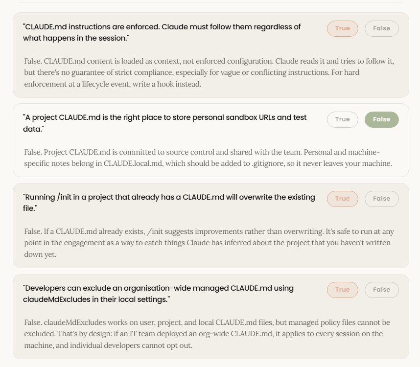
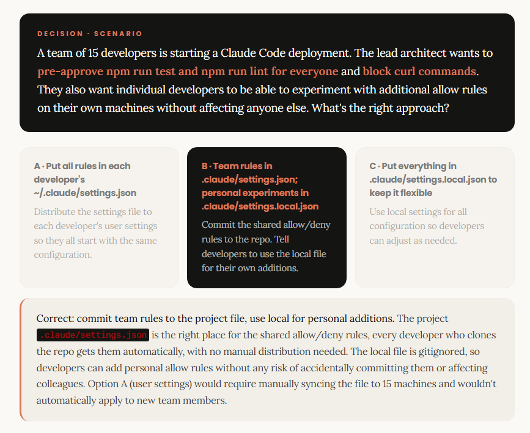

# Configuration and Customization

## Configuration Hierarchy and Precedence

<span style="font-size: 1.25em;">_One config doesn't fit all. Four scopes solve that._</span>

By the end of this lesson, you will know which scope wins when settings conflict and which one to reach for on a client engagement.

### Why four scopes?

<span style="font-size: 1.15em;">_There are four places Claude reads config, and they don't carry equal weight._</span>

Claude Code reads configuration from four sources. When the same setting appears in more than one place, a fixed priority order decides which value applies.

The four sources are **Managed** (deployed by IT, the highest priority), **Local** (personal project overrides, git-ignored), **Project** (team-shared settings committed to the repo), and **User** (personal defaults that follow you across all projects). Each scope can only be overridden by something above it in the chain. Permissions are the exception: allow and deny lists merge across scopes rather than override, so a developer's local configuration adds to the project's rules rather than replacing them.

> [!Tip]
> <small>WORKING RULE</small>
>
> Scope is an **ownership question** before it is a technical one. Who controls this setting? Who should it affect? Can they override it? Answer those three questions and the right scope picks itself.

### The four scopes

<span style="font-size: 1.15em;">_Each scope has a fixed location and a defined audience._</span>

These two facts are what you need to choose the right one on any client engagement.

| | |
| :-- | :-- |
| <span class="font-size-xl" style="font-size: 1.5em;">**M**</span><br><span class="font-size-lg" style="font-size: 1.15em;">**Managed**</span><br><br>Deployed by IT via MDM, Group Policy, or a system-level config file. Applies to every session on the machine. Cannot be overridden by any user or project setting.[cite: 5]<br><br>*macOS: /Library/Application Support/ClaudeCode/ · Linux: /etc/claude-code/*[cite: 5] | <span class="font-size-xl" style="font-size: 1.5em;">**L**</span><br><span class="font-size-lg" style="font-size: 1.15em;">**Local**</span><br><br>Personal overrides for one specific project. Git-ignored automatically when Claude Code creates the file. Applies only to you, only in this repo.[cite: 5]<br><br>*.claude/settings.local.json*[cite: 5] |
| <span class="font-size-xl" style="font-size: 1.5em;">**P**</span><br><span class="font-size-lg" style="font-size: 1.15em;">**Project**</span><br><br>Shared team settings committed to git. Applies to everyone working on this repo. Use for allowed and denied tools, hooks, and approved MCP servers.[cite: 5]<br><br>*.claude/settings.json*[cite: 5] | <span class="font-size-xl" style="font-size: 1.5em;">**U**</span><br><span class="font-size-lg" style="font-size: 1.15em;">**User**</span><br><br>Personal defaults across all your projects. Lowest priority: applies when no higher scope has set the value. Use for preferred model, editor keybindings, notification preferences.<br><br>*~/.claude/settings.json* |
| | |

### Precedence

<span style="font-size: 1.15em;">_Managed can't be overridden. User is the last resort._</span>

When Claude Code resolves a setting, it walks this chain from top to bottom and takes the first value it finds.

| | |
| :-- | :-- |
| <span class="font-size-lg" style="font-size: 1.25em;">**1**</span> | <span class="font-size-lg" style="font-size: 1.15em;">**Managed: highest authority**</span><br><br>Set by IT or DevOps via a system-level file. Applies to the whole machine. No user or project setting can override it. This is where client compliance requirements belong. |
| <span class="font-size-lg" style="font-size: 1.25em;">**2**</span> | <span class="font-size-lg" style="font-size: 1.15em;">**CLI flags: session-level overrides**</span><br><br>Flags passed when launching Claude Code, such as `--allowedTools` or `--model`. Override all file-based settings for that session only. Not persisted. |
| <span class="font-size-lg" style="font-size: 1.25em;">**3**</span> | <span class="font-size-lg" style="font-size: 1.15em;">**Local: personal project override**</span><br><br>`.claude/settings.local.json` in the repo. Your personal config for this project. Overrides project settings for your session only, without changing the shared file. |
| <span class="font-size-lg" style="font-size: 1.25em;">**4**</span> | <span class="font-size-lg" style="font-size: 1.15em;">**Project: shared team baseline**</span><br><br>`.claude/settings.json` committed to git. Every collaborator on the repo gets these settings. Use for team standards: pre-approved commands, hooks, MCP servers. |
| <span class="font-size-lg" style="font-size: 1.25em;">**5**</span> | <span class="font-size-lg" style="font-size: 1.15em;">**User: personal fallback**</span><br><br>`~/.claude/settings.json`. Applies when nothing above has set the value. The lowest priority in the chain. |
| | |

> [!Important]
> <small>PERMISSION MERGE EXCEPTION</small>
>
> Allow and deny rule lists are merged across scopes, not overridden. A `settings.local.json` allow rule adds to the project's list. A developer can expand their own permissions locally, but cannot remove a deny rule set at project or managed scope.

### Choosing your scope

<span style="font-size: 1.15em;">_The question isn't what you're configuring. It's who owns it._</span>

On most client engagements, the two decisions that matter most are whether a setting travels with the repo and whether it should be private to one developer.

| | |
| :-- | :-- |
| <span style="font-size: 0.8em;">**PROJECT SCOPE**</span><br><br><span style="font-size: 1.4em;">**Travels with the repo**</span><br><br>Any setting the whole team needs: pre-approved commands, denied tools, MCP server config, hooks. Committed to git, so every developer who checks out the repo gets it automatically. Change it once, it applies to everyone.<br><br>`.claude/settings.json` | <span style="font-size: 0.8em;">**LOCAL SCOPE**</span><br><br><span style="font-size: 1.4em;">**Stays on your machine**</span><br><br>Personal config for this project: sandbox URLs, test credentials, experimental settings you're not ready to share. Git-ignored automatically. No risk of accidentally committing it or applying it to anyone else.<br><br>`.claude/settings.local.json` |
| | |

## CLAUDE.md: company-wide vs. repo-specific memory

<span style="font-size: 1.25em;">_`CLAUDE.md` is your project's persistent memory._</span>

By the end of this lesson, you'll know how to use `CLAUDE.md` to give Claude persistent project context, so you stop re-explaining the same things every session.

### The Memory Hierarchy

<span style="font-size: 1.15em;">_Five scopes, loaded broadest to most specific_</span>

`CLAUDE.md` files can live in several locations. **They don't override each other - they concatenate**. Claude reads all of them, from the broadest scope down to the most specific, so a project instruction appears in context after an org-wide policy.

| | |
| :-- | :-- |
| <span style="font-size: 0.8em;">**MANAGED POLICY**</span><br><br><span style="font-size: 1.4em;">**Organisation-wide**</span><br><br>Deployed by IT via configuration management. Applies to every session on the machine. Cannot be excluded by developers. It's always loaded.<br><br>`macOS: /Library/Application Support/ClaudeCode/CLAUDE.md`<br>`Linux: /etc/claude-code/CLAUDE.md or /etc/claude/CLAUDE.md`<br>`Windows: %ProgramData%\ClaudeCode\CLAUDE.md` | <span style="font-size: 0.8em;">**USER**</span><br><br><span style="font-size: 1.4em;">**Personal defaults**</span><br><br>Your preferences across all projects: coding style, error handling approach, personal shortcuts. Follows you everywhere.<br><br>`~/.claude/CLAUDE.md` |
| <span style="font-size: 0.8em;">**PROJECT**</span><br><br><span style="font-size: 1.4em;">**Team instructions**</span><br><br>Architecture decisions, coding standards, build commands, and common workflows. Committed to source control and shared with the team. The most important one to get right.<br><br>`./CLAUDE.md or ./.claude/CLAUDE.md` | <span style="font-size: 0.8em;">**LOCAL**</span><br><br><span style="font-size: 1.4em;">**Personal project notes**</span><br><br>Your sandbox URLs, personal test data, or notes you don't want committed. Add CLAUDE.local.md to .gitignore.<br><br>`./CLAUDE.local.md` |
| | |

For large repos, `CLAUDE.md` files in subdirectories load on demand, when Claude reads files in that directory, rather than at session start. In a monorepo, your `frontend/`, `backend/`, and `test-cases/` subdirectories each carry their own `CLAUDE.md` with context relevant to that module. Claude loads them only when working in those directories, keeping the initial context lean.

### What to Include

Write what you'd otherwise re-explain every session
The test for inclusion is simple: if you typed it into chat last session, it belongs in `CLAUDE.md`. If Claude does it right without the rule, delete it.

Add to `CLAUDE.md` when Claude makes the same mistake twice, when a code review catches something Claude should have known about this codebase, when you type the same correction into chat that you typed last session, or when a new team member would need the same context to be productive. Keep it to facts Claude should hold in every session: build commands, naming conventions, architectural decisions, "always do X" rules. If an entry is a multi-step procedure or only matters for one part of the codebase, move it to a skill or a path-scoped rule instead.

> [!Tip]
> <small>THE PRUNING RULE</small>
>
> If Claude does it right without the instruction, delete the instruction. Bloated `CLAUDE.md` files degrade adherence, shorter is more effective.

### Writing That Works

<span style="font-size: 1.15em;">_Specific beats general, every time_</span>

`CLAUDE.md` instructions are loaded as context, not enforced configuration. How you write them determines how consistently Claude follows them.

| | |
| :-- | :-- |
| <span style="font-size: 0.8em;">**VAGUE: DOESN'T WORK**</span><br><br><span style="font-size: 1.4em;">**Format code properly**</span><br><br>Too abstract to act on. Claude might interpret "properly" differently every session. Nothing about this instruction can be verified. | <span style="font-size: 0.8em;">**SPECIFIC: WORKS**</span><br><br><span style="font-size: 1.4em;">**Use 2-space indentation. Run npm test before committing.**</span><br><br>Concrete enough to verify. Claude can check whether it followed the rule. Reviewers can check too. |
| | |

**Target under 200 lines per `CLAUDE.md` file**. Longer files consume more context and reduce adherence. Use markdown headers to group related instructions. Link to documentation using `@path/to/file` syntax instead of copying content, the imported file loads at session start alongside the `CLAUDE.md` that references it. Run `/init` in a new project to bootstrap a `CLAUDE.md` automatically, Claude analyses your codebase and drafts build commands, conventions, and project structure. Refine from there.

### Large Repo Patterns

<span style="font-size: 1.15em;">_In a monorepo, the hierarchy works for you_</span>

Enterprise client repos are rarely a single codebase. The `CLAUDE.md` hierarchy is designed for this. Each module carries its own context, and Claude loads it only when relevant.

A well-structured enterprise monorepo might carry `CLAUDE.md` files at the monorepo root (system overview, team structure, modernisation strategy), at each service boundary (API design, data models, service architecture for the backend; UI patterns and component library for the frontend), and in the test-cases directory (coverage requirements, automation strategy). The root-level `CLAUDE.md` loads at every session. The subdirectory files load on demand when Claude touches files in that area. If another team's `CLAUDE.md` files are getting picked up and creating noise, use `claudeMdExcludes` in your local settings to skip them, this works from any scope except managed policy.

### Check your understanding

Four statements about CLAUDE.md. True or false?
These are the misconceptions that show up most often when teams first configure Claude Code on an engagement.



## settings.json vs. settings.local.json conventions

<span style="font-size: 1.25em;">_Two files. One shared, one yours._</span>

By the end of this lesson, you'll know exactly what belongs in the shared settings file and what belongs in your personal one, so you never accidentally commit a personal override into the team config.

### The Two Files

<span style="font-size: 1.15em;">_Same format, opposite purposes_</span>

Both files use the same JSON format and live in the `.claude/` directory of your project. The difference is entirely about ownership and visibility.

| | |
| :-- | :-- |
| <span style="font-size: 0.8em;">**SHARED · .CLAUDE/SETTINGS.JSON**</span><br><br><span style="font-size: 1.4em;">**The team's configuration**</span><br><br>Committed to git. Every developer who clones this repo picks up these settings automatically. Use for anything that should apply consistently across the whole team.<br><br>• Permission allow/deny rules<br><br>• Hook definitions<br><br>• Approved MCP server configurations<br><br>• Company announcements | <span style="font-size: 0.8em;">**PERSONAL · .CLAUDE/SETTINGS.LOCAL.JSON**</span><br><br><span style="font-size: 1.4em;">**Your configuration**</span><br><br>Gitignored automatically when Claude Code creates it. Never committed. Use for personal overrides, experimental configurations, and anything machine-specific.<br><br>• Personal permission mode preferences<br><br>• Experimental config you're testing<br><br>• Machine-specific tool paths<br><br>• Excluding noise from other teams' CLAUDE.md files |
| | |

### What Goes Where

<span style="font-size: 1.15em;">_If it only works on your machine, it doesn't go in the shared file_</span>

Here's a well-structured project settings file for a team deployment. This is what you'd commit to the repo at the start of an engagement.

```json
// .claude/settings.json (shared with the team
// and committed to git)
{
  "$schema": "https://json.schemastore.org/claude-code-settings.json",
  "permissions": {
    "allow": [
      "Bash(npm run lint)",
      "Bash(npm run test *)",
      "Bash(git status)",
      "Bash(git log *)"
    ],
    "deny": [
      "Bash(curl *)",
      "Read(./.env)",
      "Read(./.env.*)",
      "Read(./secrets/**)"
    ]
  },
  "companyAnnouncements": [
    "Review our coding guidelines at docs.acme.com/claude"
  ]
}
```

Notice what's **not** in the shared file: the `model preference` (that's a user setting), `environment variables with credentials` (never in a committed file), and any `defaultMode` override (that goes in the developer's local file). The `$schema` line enables autocomplete and inline validation in VS Code and Cursor, worth including in every project settings file you set up for a client.

### Permissions Structure

<span style="font-size: 1.15em;">_Deny evaluates first. Then ask. Then allow._</span>

Permission rules follow a fixed evaluation order, and they merge across scopes rather than override. A developer's local allow list adds to the project's rules; it doesn't replace them.

| | |
| :-- | :-- |
| <span style="font-size: 1.4em;"><b>1</b></span> | <span style="font-size: 1.4em;">**Deny rules evaluated first**</span><br><br>If any deny rule matches the tool use, it's blocked, regardless of what allow rules say. Use deny to protect sensitive files and block risky commands. Example: `Read(./.env)` |
| <span style="font-size: 1.4em;"><b>2</b></span> | <span style="font-size: 1.25em;">**Ask rules evaluated next**</span><br><br>If no deny rule matches but an ask rule does, Claude prompts for confirmation. Useful for potentially risky operations you want humans to approve. Example: `Bash(git push *)` |
| <span style="font-size: 1.4em;"><b>3</b></span> | <span style="font-size: 1.25em;">**Allow rules evaluated next**</span><br><br>If a matching allow rule exists, the tool use proceeds without a prompt. Use for safe, commonly used commands you don't want interrupting the workflow. Example: `Bash(npm run test *)` |
| <span style="font-size: 1.4em;"><b>4</b></span> | <span style="font-size: 1.25em;">**Default: ask**</span><br><br>No rule matched. Claude asks for confirmation. This is the safe default: unknown tool uses require human approval. |
| | |



## Custom slash Commands

<span style="font-size: 1.25em;">_If you prompt it more than twice, make it a command._</span>

By the end of this lesson, you'll be able to build a custom slash command from scratch and ship it as a reusable team asset.

### What Commands Are

A command is a Markdown file with YAML frontmatter
There's no special syntax to learn. Custom slash commands turn repeated prompts into reusable, version-controlled team assets. Any `.md` file you drop into `.claude/commands/` becomes a slash command automatically. The filename determines the command name.

| | |
| :-- | :-- |
| <span style="font-size: 0.8em;">**LOCATION**</span><br><br><span style="font-size: 1.4em;">**.claude/commands/**</span><br><br>Project-level. Committed to git. Available to every developer on the team.<br><br>`Appears in Claude as /<filename>` | <span style="font-size: 0.8em;">**FILENAME**</span><br><br><span style="font-size: 1.4em;">**Becomes the command name**</span><br><br>Nest files inside folders to create namespaces.<br><br>`review-pr.md → /review-pr · security/audit.md → /security:audit` |
| <span style="font-size: 0.8em;">**FRONTMATTER**</span><br><br><span style="font-size: 1.4em;">**Optional YAML metadata**</span><br><br>Controls behaviour: which tools the command can invoke, and what shows in the command picker.<br><br>`allowed-tools · description` | <span style="font-size: 0.8em;">**ARGUMENTS**</span><br><br><span style="font-size: 1.4em;">**\$ARGUMENTS placeholder**</span><br><br>Use it anywhere in the prompt body to pass text from the command invocation.<br><br>`/review-pr 1234` |
| | |

Build a Command
From blank file to working command in four lines
Here's a complete custom command for reviewing pull requests against an engagement's security checklist. This is the kind of command worth shipping as a reusable artifact for clients.

`.claude/commands/review-pr.md`

```yaml
---
description: Review a pull request against the security checklist
allowed-tools: Read, Bash(git *)
---

## PR Review: $ARGUMENTS

You are reviewing PR $ARGUMENTS against Acme Corp's security checklist.

Run `git diff main` to inspect the changed files, then evaluate:

- No credentials, tokens, or API keys in changed files
- No new eval() or dynamic code execution patterns
- No new external network calls without logging
- Dependency changes have corresponding security review notes

Summarise your findings as: approved / needs changes / blocked.
For each finding, cite the specific file and line number.
```

Invoked as `/review-pr 847`. Claude substitutes `$ARGUMENTS` with `847`, restricts tool use to `Read` and `Bash(git *)`, and runs the checklist evaluation automatically.

> [!Tip]
> <small>DESIGN PRINCIPLE</small>
>
> Write the command for the person who'll use it on the worst day of a sprint: under pressure, context-switching. The prompt body should be specific enough to run without thinking and short enough to read in under 30 seconds.

### Scope

<span style="font-size: 1.25em;">_Team commands vs. personal commands_</span>

Commands in `.claude/commands/` are project-level, committed to the repo and shared across the team. Personal commands live in `~/.claude/commands/` and are available in every project on that machine. Neither type requires registration or restart, Claude discovers new command files automatically. On a client engagement, the distinction matters: ship team commands to the repo as a delivery artifact, and coach individual developers to build their own personal library of shortcuts that persist across engagements.

## Output Styles

<span style="font-size: 1.25em;">_Change how Claude talks to you._</span>

By the end of this lesson, you'll be able to configure an output style that fits how your team works and recognize when to write a custom one instead.

### Two different levers

<span style="font-size: 1.`5em;">_`CLAUDE.md` is what Claude knows. Output styles are how Claude communicates._</span>

Both shape how Claude behaves in a session, but they operate on different things. Getting this distinction right helps you advise clients on which one to reach for.

`CLAUDE.md` gives Claude project memory: architecture, conventions, build commands, team standards. It's injected into the system prompt once, at session start, and tells Claude what it needs to know about the codebase. 

`Output styles` modify the system prompt to change communication tone and format, not knowledge. They affect how Claude presents its work: how much explanation it adds, whether it executes proactively or waits for explicit instructions, whether it leaves TODO markers for the developer to fill in. A team can have both: a CLAUDE.md that encodes project context and an output style that matches how that team wants to work.

> [!Important] 
> <small>SESSION START CONSTRAINT</small>
>
> Output styles modify the system prompt at session start. Changing the setting mid-session has no effect. Changes apply after `/clear` or in a new session.

### Built-in styles

<span style="font-size: 1.25em;">_Four options. Default for most. Each other style fits a specific activation phase._</span>

Set via `/config` in the session (saves to `settings.local.json`), or set `"outputStyle": "Explanatory"` directly in any settings file at the right scope.

| | | |
| :-- | :-- | :-- |
| <span style="font-size: 1.8em;">**01**</span><br><br><span style="font-size: 1.2em;">**Explanatory**</span><br><br>Adds "Insights" sections explaining implementation choices and codebase patterns. The right call for an adoption phase, when engineers need to understand what Claude is doing, not just accept the output. | <span style="font-size: 1.8em;">**02**</span><br><br><span style="font-size: 1.2em;">**Proactive**</span><br><br>Executes immediately and makes reasonable assumptions rather than asking. Faster and more autonomous than Default, but still shows permission prompts for consequential actions. | <span style="font-size: 1.8em;">**03**</span><br><br><span style="font-size: 1.2em;">**Learning**</span><br><br>Collaborative mode. Explains reasoning AND places `TODO(human)` markers at key decision points, so developers complete critical pieces rather than accepting everything wholesale. |
| | | |

> [!Important]
> <small>THE FOURTH: dEFAULT</small>
>
> Standard engineering mode: efficient, precise, no added commentary. Leave it here unless there's a specific reason to change it. Most production teams don't need a different style once they're past initial adoption.

### Custom styles

<span style="font-size: 1.15em;">_When none of the built-ins fit, write your own._</span>

A custom output style is a Markdown file with YAML frontmatter, stored in .claude/output-styles/ at project, user, or managed level.

| | |
| :-- | :-- |
| <span style="font-size: 0.8em;">**KEEP-CODING-INSTRUCTIONS: TRUE**</span><br><br><span style="font-size: 1.4em;">**Adding a layer on top**</span><br><br>Retains Claude's built-in engineering instructions (how to scope changes, verify work, write comments) and adds your communication format on top. Use for styles like "always lead with a diagram" or "structure all output as client-ready artifacts with headers, recommendations, and next steps." | <span style="font-size: 0.8em;">**KEEP-CODING-INSTRUCTIONS: FALSE (DEFAULT)**</span><br><br><span style="font-size: 1.4em;">**Replacing the persona entirely**</span><br><br>Claude's built-in engineering instructions are removed. Use when Claude isn't doing software engineering at all: a writing assistant, a data analyst, a requirements formatter. The default is false, so omitting the flag removes the engineering context entirely. |
| | |

Three patterns that come up on GSI engagements: an engagement docs style that structures all output as client-ready artifacts with structured headers and next steps; a security review style that formats every finding with severity, file path, line number, and recommended fix; and an onboarding mode that adds explanatory commentary for junior developers joining mid-engagement. All three use keep-coding-instructions: true.
