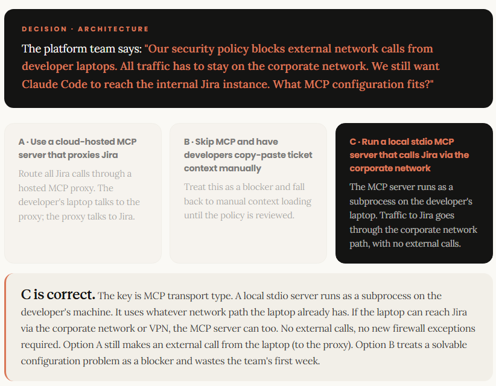

# Extensibility

## MCP servers: ticketing, error logs, internal systems

<span style="font-size: 1.25em;">_MCP connects Claude Code to your client's systems._</span>

By the end of this lesson you can connect Claude Code to a client's ticketing, error monitoring, or internal API and explain the connection model to the client's platform team in terms they'll understand.

### The connection model

<span style="font-size: 1.15em;">_MCP reaches outside the terminal to connect Claude to the client's tools_</apan>

Claude Code ships with tools for reading files, running code, and searching the web. MCP is the standard that lets you add more, specific to the client's environment, specific to the engagement.

MCP (Model Context Protocol) is an open standard for connecting Claude to external systems. When you install an MCP server, you're giving Claude three new categories of capability in that environment. The model stays the same; what it can reach changes.

| | |
| :-- | :-- |
| <span style="font-size: 1.8em;">**01**</span><br><br><span style="font-size: 1.2em;">**Tools**</span><br><br>Actions Claude can take in the external system: creating a ticket, querying a database, triggering a pipeline run. The model decides which tool to call and what to pass it. | <span style="font-size: 1.8em;">**02**</span><br><br><span style="font-size: 1.2em;">**Resources**</span><br><br>Data Claude can read from the external system: open tickets, recent error logs, API schemas. Loaded into context on demand, not constantly. |
| <span style="font-size: 1.8em;">**03**</span><br><br><span style="font-size: 1.2em;">**Prompts**</span><br><br>Reusable context templates the server exposes, such as a standardised preamble that loads the client's API documentation before any coding task. | <span style="font-size: 1.8em;">**04**</span><br><br><span style="font-size: 1.2em;">**Scoping**</span><br><br>MCP servers can be project-level (one repo), user-level (one developer), or org-level (all developers). The right scope depends on whether this is personal setup or a team deployment. |
| | |

### Installation

<span style="font-size: 1.15em;">_One install command—config placement determines scope_</span>

The install pattern is consistent across all MCP servers. Where the config file lands is what changes.

Run `claude mcp add` followed by the server name and any configuration the server requires. For `--scope project`, Claude Code writes the result to `.mcp.json`; the default local scope writes to `~/.claude.json`. Three real examples from the Activation Plan starter kit:

```bash
# Ticketing - pull issue context before writing a fix
claude mcp add linear

# Browser automation and end-to-end testing
claude mcp add --transport stdio playwright -- npx @playwright/mcp@latest

# Verify the server loaded and check what tools it exposed
/mcp
```

After installation, run `/mcp` at the start of any session to see the connected MCP servers and the tools they expose. That list is what Claude can actually reach in the current session.

Config placement: `.mcp.json` in the project root scopes the server to that project only. `~/.claude.json` with `--scope user` makes it available across all of that developer's projects. **Note:** the default scope (local) also writes to `~/.claude.json` but keys it to the current project; the server won't appear elsewhere. Org-level deployment goes through `managed-settings.json` (covered in the next lesson).

### Engagement scenarios

<span style="font-size: 1.15em;">_Three MCP archetypes that come up on nearly every activation_</span>

The Activation Plan pre-kickoff checklist asks: what MCP servers does this client already use? These are the categories to inventory.

| | | |
| :-- | :-- | :-- |
| <span style="font-size: 1.8em;">**01**</span><br><br><span style="font-size: 1.2em;">**Ticketing systems**</span><br><br>Jira, Linear, GitHub Issues. Claude pulls ticket context before writing a fix: no copy-paste, no context loss. The "Ticket to PR" pattern from the Enablement Deck starts here. Without this connection, developers manually copy ticket descriptions into the session. | <span style="font-size: 1.8em;">**02**</span><br><br><span style="font-size: 1.2em;">**Error logs and observability**</span><br><br>OTel, Datadog, Sentry. Claude reads recent error traces directly when debugging. This compresses the loop between "error appeared in production" and "fix is underway." For clients doing modernisation work, this is high signal. | <span style="font-size: 1.8em;">**03**</span><br><br><span style="font-size: 1.2em;">**Internal systems**</span><br><br>Private APIs, internal databases, service catalogues, Confluence, proprietary tooling. These require a custom or client-built MCP server, or the MCP tunnel when the system isn't reachable from the developer's laptop. Both are covered in Lesson 5.3. |
| | | |

### The framing that lands with clients

<span style="font-size: 1.15em;">_MCP is a context amplifier, not a data integration project_</span>

The business case for MCP isn't `"Claude can read Jira."` It's something sharper than that.

When a developer fixes a bug today, they open the ticket, read the description, switch to the editor, open the relevant files, then start typing. MCP collapses the first two steps: when the ticket context is already loaded into Claude's session, the developer starts with Claude already oriented — no context loss.

#### What this means for security and platform teams

For the security and platform teams, the framing depends on how the MCP server authenticates. For OAuth-scoped servers, Claude inherits the user's own permissions — the MCP server surfaces what the user already has access to, nothing more. That distinction usually resolves the "what can Claude see?" question in the security review. But servers using static API keys, service accounts, or `headersHelper` credentials may grant access that differs from the user's own. Always confirm how the MCP server authenticates and what tools it exposes before deploying to a team.

> [!Important]
> <small>FRAMING FOR THE CLIENT CONVERSATION</small>
>
> Properly scoped MCP servers should not grant access beyond what the user or configured credential can reach. It reduces how many context switches developers make to get there. Always review how the MCP server authenticates and what it exposes before deployment.

### Engagement scenario

**The platform team has a constraint**: `You're setting up MCP on Day 3 of the activation. The client's platform team flags a restriction.`



## Approved-server governance and the MCP allowlist

<span style="font-size: 1.25em;">_Developers will ask. You need a defensible answer._</span>

By the end of this lesson you can configure the MCP server allowlist, explain the approval workflow to a client's security team, and handle the most common objection.

### Defense in depth

<span style="font-size: 1.15em;">_MCP governance sits inside a layered security model you already brief clients on_</span>

Anthropic's defense-in-depth framework has five layers. MCP allowlisting sits in Layer 02, the platform and runtime layer. It's not a standalone MCP policy; it's part of how Claude Enterprise handles all connector access.

| | |
| :-- | :-- |
| <span style="font-size: 1.8em;">**01**</span><br><br><span style="font-size: 1.2em;">**Identity & environment**</span><br><br>SSO, SCIM provisioning, RBAC, and network access controls. The enterprise perimeter you already brief clients on — who gets access and at what level. Owned by the client's own infrastructure. | <span style="font-size: 1.8em; color: #cc6d50;">**02**</span><br><br><span style="font-size: 1.2em;color: #cc6d50;">**Platform & runtime ← this lesson**</span><br><br>Where a request actually runs: surfaces, sandboxes, egress, and connector consent. MCP allowlisting lives here. Owned jointly — Anthropic controls the platform; your org controls the policy configuration. |
| <span style="font-size: 1.8em;">**03**</span><br><br><span style="font-size: 1.2em;">**Runtime safety**</span><br><br>Anthropic-run classifiers, per-surface system prompts, and usage policy enforcement wrapped around every model call. Catches novel jailbreaks and abuse patterns without requiring a model retrain. | <span style="font-size: 1.8em;">**04**</span><br><br><span style="font-size: 1.2em;">**Model safety**</span><br><br>Safety properties trained directly into the weights — Constitutional AI, RLHF, and trained-in refusal. The layer no system prompt can undo. Owned entirely by Anthropic. |
| <span style="font-size: 1.8em;">**05**</span><br><br><span style="font-size: 1.2em;">**Observability & audit**</span><br><br>Audit logs, Compliance API, OpenTelemetry, and analytics that cut across every other layer. Feeds the client's SIEM, legal hold, and compliance stack. Covered in the Administration module. | |
| | |

This lesson focuses on Layer 02. The specific controls you configure — the MCP server allowlist and egress domain restrictions — sit inside the platform and runtime layer, sandwiched between the identity perimeter the client already owns and the Anthropic-managed safety stack below. That framing matters in the security conversation: you're not asking a client to trust Claude with ungoverned connector access. You're showing them exactly where their policy levers sit within a stack that has four other layers running independently of what any developer can install.

### Two control planes

<span style="font-size: 1.15em;">_User-installed and org-deployed servers are governed differently_</span>

Within Layer 02, there are two distinct mechanisms for getting an MCP server into a developer's environment — and they're governed differently. Understanding this split is essential for the security conversation. Most clients conflate the two, which is why the CISO's question ("can developers install anything?") has a nuanced answer.

| | |
| :-- | :-- |
| <span style="font-size: 0.8em;">**USER-INSTALLED**</span><br><br><span style="font-size: 1.4em;">**Developer-controlled via local .mcp.json**</span><br><br>A developer can add a server to their own `~/.claude.json` or the project's `.mcp.json`. This affects only their own sessions. It's the developer's responsibility. To fully restrict user installs, the admin sets the override policy to deny in `managed-settings.json`. | <span style="font-size: 0.8em;">**ORG-DEPLOYED**</span><br><br><span style="font-size: 1.4em;">**Two mechanisms: allowlist filtering and managed deployment**</span><br><br><span style="font-size: 1.2em;">**Deployment:**</span> `managed-mcp.json` pushes fixed servers to every user automatically — no user action required.<br><br><span style="font-size: 1.2em;">**Filtering:**</span> `allowedMcpServers` in `managed-settings.json` controls which servers developers are allowed to add themselves. Setting `allowManagedMcpServersOnly: true` enforces the filter. These are separate controls — configure both on Day 0. |
| | |

### Day 0 configuration

<span style="font-size: 1.15em;">_The allowlist goes into managed-settings.json before kickoff_</span>

The 30-Day Activation Plan lists MCP allowlist setup as a minimum org-level prerequisite for Day 0, alongside SSO/SCIM and spend reporting. It's not optional. Without an enforced MCP policy, developers may be able to connect to unapproved MCP servers — which creates the security exposure the client is trying to avoid.

Work with the client's platform or security team to define the initial approved server list. The pre-kickoff MCP inventory (what servers the team already uses) feeds directly into this. A practical starting set for most code-focused activations:

```json
// managed-settings.json — MCP allowlist section
// allowedMcpServers entries must be objects, not bare strings
{
    "allowManagedMcpServersOnly": true, // prevents unapproved installs
    "allowedMcpServers": [
        { "serverUrl": "https://api.github.com/*" }, // code context, PR operations
        { "serverUrl": "https://linear.app/mcp/*" }, // ticketing and issue context
        { "serverCommand": ["npx", "-y", "@playwright/mcp@latest"] }, // browser automation / testing
        { "serverUrl": "https://*.client-internal.com/*" } // internal systems
    ]
}
```

The `allowManagedMcpServersOnly: true` flag is the answer to the CISO's question. With it set, developers cannot install servers outside the approved list. Without it, the list is advisory, not enforced.

### Engagement rhythm

<span style="font-size: 1.15em;">_New server requests need a standing review process, not an ad hoc one_</span>

The initial allowlist won't cover everything the team needs by Week 3. Build the review process in Week 1 so requests don't stall the engagement.

| | |
| :-- | :-- |
| 1 | <span style="font-size: 1.4em;">**Pre-kickoff: inventory what already exists**</span><br><br>The consultant and CoE lead catalogue MCP servers the team uses today. These go straight onto the approved list with no new evaluation needed. Unvetted servers get flagged for review. |
| <span style="color: #cc6d50;">2</span> | <span style="font-size: 1.4em;">**Day 0: set the initial allowlist with the security team**</span><br><br>Work with IT or the platform team to load the approved server list into `managed-settings.json`. Confirm egress domains. Set the user install policy. Share the pre-kickoff inventory 48 hours in advance so the team arrives ready to confirm, not to review for the first time. It should take under an hour. |
| 3 | <span style="font-size: 1.4em;">**Weekly: CoE touchpoint includes connector approvals**</span><br><br>The standing weekly CoE meeting covers governance. New connector requests go here. The CoE lead owns the decision; the security team reviews the egress domain for anything non-standard. Turnaround should be same-week, not same-month. |
| | |

## MCP Tunnel - Bridging Local Development

<span style="font-size: 1.25em;">_The client's internal API isn't reachable. The relay is._</span>

By the end of this lesson you know when to use the remote MCP relay pattern, how to set it up, and how to explain it to a client's platform team without it becoming a security escalation.

### The last-mile problem

<span style="font-size: 1.15em;">_Allowlisted but unreachable: when the remote MCP relay bridges the gap_</span>

The MCP allowlist controls what can be approved. The relay controls what's actually reachable. They solve different problems.

The scenario comes up on nearly every enterprise engagement: a developer needs Claude Code to connect to an internal REST API, a database, or a private service. The system is legitimate and already approved for MCP access. But it only accepts connections from inside the corporate network, and Claude Code is running on a developer's laptop that can't directly reach it.

Without this MCP tunnel, the developer copies API responses manually into the Claude Code session. That works for a one-off task. It's unsustainable for a team, and it defeats the purpose of the MCP connection.

> [!Important]
> <small>WHAT THE RELAY ACTUALLY DOES</small>
>
> The remote MCP relay is a relay between Claude Code and an MCP server running inside the client's network. The developer's laptop talks to the relay endpoint; the relay endpoint talks to the internal system. The security boundary stays intact.

The relay pattern is the same concept as a reverse proxy or API gateway: the relay sits between the client and the target system, and only the defined protocol passes through it.

### Architecture decision

<span style="font-size: 1.15em;">_Use the relay pattern only when direct connection isn't possible_</span>

The relay adds latency and an extra point of failure. Don't use it if a direct connection works.

| | |
| :-- | :-- |
| <span style="font-size: 0.8em;">**DIRECT MCP CONNECTION**</span><br><br><span style="font-size: 1.4em;">**Target system is reachable from the developer's environment**</span><br><br>SaaS tools (GitHub, Linear, Slack), VPN-accessible systems, or anything the developer's machine can reach directly. Run `claude mcp add` and the connection works. No tunnel needed. | <span style="font-size: 0.8em;">**REMOTE MCP RELAY**</span><br><br><span style="font-size: 1.4em;">**Target system is behind a network boundary the laptop can't cross**</span><br><br>Internal APIs that only accept requests from specific subnets, air-gapped environments, or systems where the client won't open a firewall rule for developer laptops. The relay bridges the gap without exposing the target internal system directly to every developer laptop. |
| | |

### Configuration

Connecting to internal systems: the relay pattern and the security conversation
The 30-Day Activation Plan introduces this connection pattern in Week 1 as part of Claude Code 101. Treat it as standard setup for any client with internal systems, not an edge case.

The approach: deploy an MCP server inside the corporate network where it can reach the internal system, then expose it via an HTTP or SSE endpoint that developers can reach over VPN. Claude Code connects using the sse or http transport. Configure it in .mcp.json:

```json
// Configure in .mcp.json — connect to an MCP server running inside the corporate network
{
    "mcpServers": {
        "internal-api": {
            "type": "sse",
            "url": "https://mcp.client-internal.com/sse"
        }
    }
}
```
```bash
# Or via the CLI
claude mcp add --transport sse internal-api https://mcp.client-internal.com/sse
```

### What the platform team needs to know

The MCP server carries only MCP protocol traffic — tool call requests and responses. It does not give Claude Code general network access to the internal environment. The MCP server running inside the network controls exactly which tools and resources are exposed. The security boundary is at the MCP server.

Authentication to the MCP endpoint can go through OAuth (for HTTP/SSE servers that support it), static headers (API keys or bearer tokens), or headersHelper for custom authentication such as internal SSO, Kerberos, or short-lived tokens. OAuth is common when the client's identity platform supports it, but not all internal systems require it. Configure authentication in .mcp.json to match how the MCP server expects credentials.

## Skills: packaging reusable task expertise


